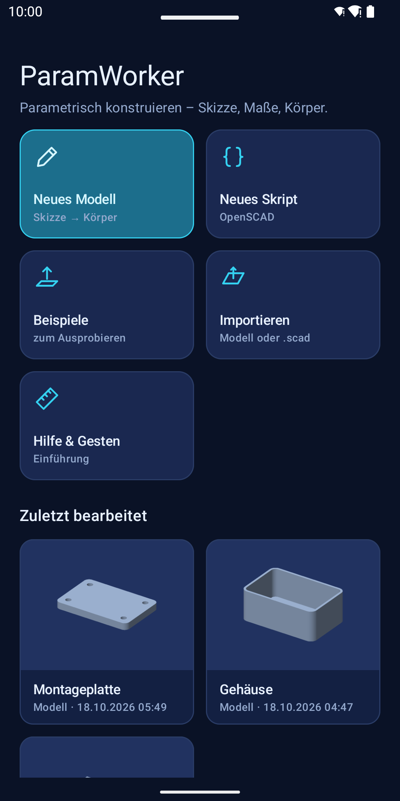
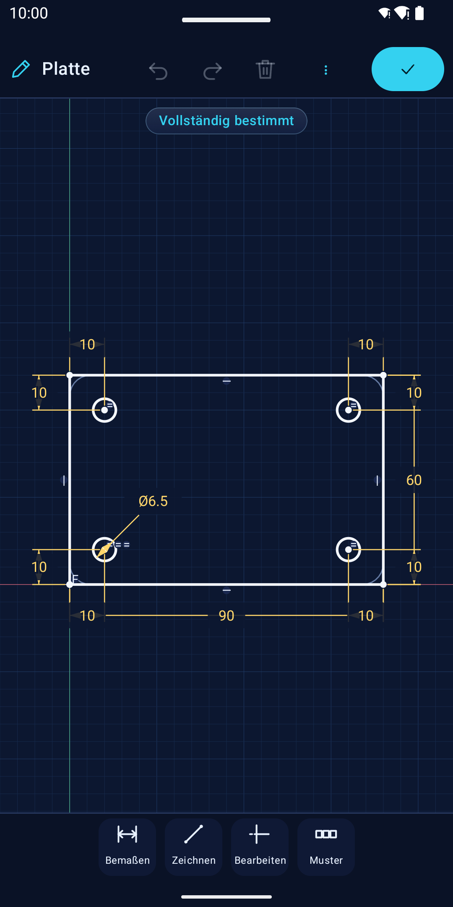
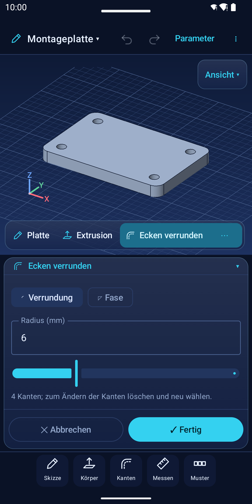
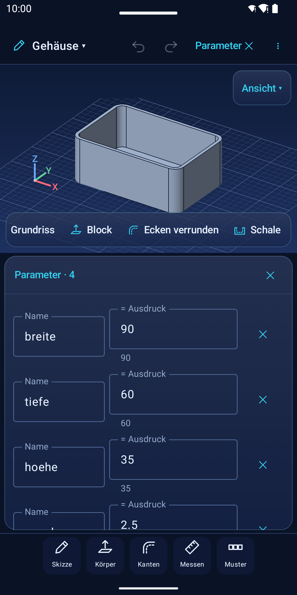
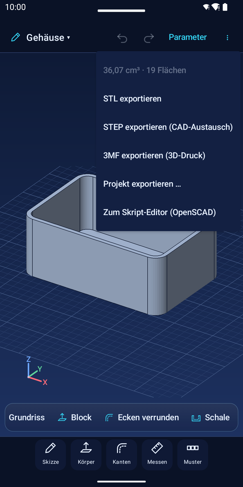
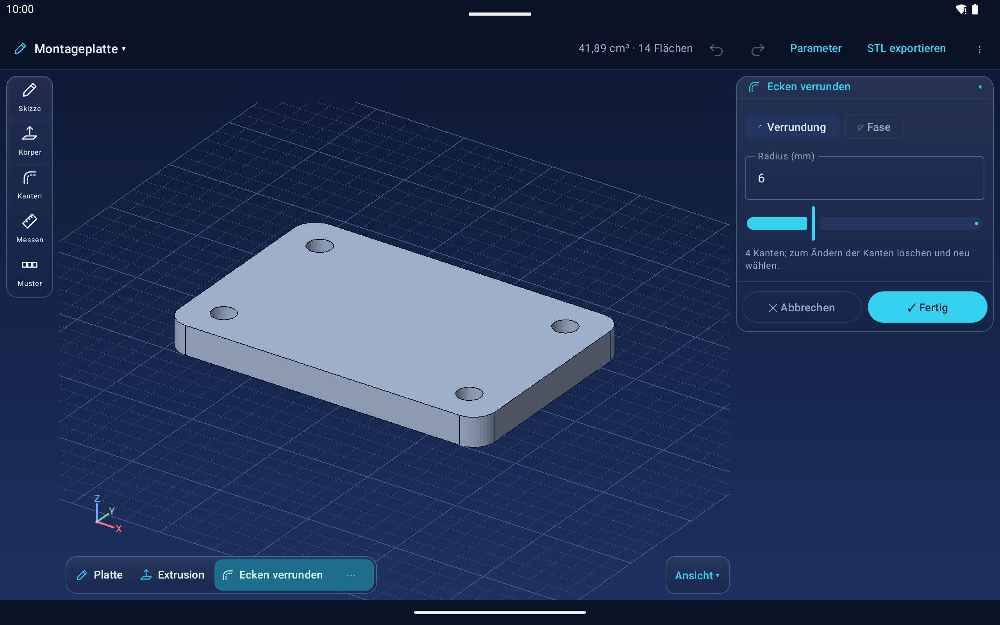

[English: README.md](README.md)

# AxisWright

AxisWright ist ein freies, quelloffenes (GPL-3.0-or-later) parametrisches 3D-CAD-Programm für Android-Tablets, Smartphones und Chromebooks. Es kombiniert exakte B-Rep-Geometrie auf Basis von Open CASCADE Technology mit einer modernen Touch- und Stiftbedienung sowie einem optionalen OpenSCAD-kompatiblen Skript-Editor mit Manifold-Geometriekern.

Die App arbeitet vollständig **offline**: ohne Benutzerkonto, ohne Cloud-Zwang, ohne Werbung, ohne Tracking und ohne Internetberechtigung.

## Screenshots

| Startseite | 2D-Skizze mit Bedingungen | 3D-Modell mit Verrundung |
|---|---|---|
|  |  |  |

| Parameter-Tabelle | Export-Menü | Tablet-Ansicht |
|---|---|---|
|  |  |  |

## Funktionen

- **Skizzieren (2D):**
  - Grundformen: Linie (auch tangential), Rechteck (Ecke, Mitte, 3 Punkte), Kreis (Mitte, 2/3 Punkte, tangential), Bogen, Langloch, regelmäßiges Vieleck, Text als Skizzenelement (für Gravur oder erhabene Beschriftung).
  - 2D-Werkzeuge: Trimmen, Verlängern, Versatz, Ecken runden, Spiegeln, Muster (Reihe und Kreis), Transformieren (Verschieben, Drehen, Skalieren und Kopieren der Auswahl).
  - Geometrische Bedingungen: 16 Constraints (horizontal, vertikal, parallel, senkrecht, tangential, konzentrisch, symmetrisch u. v. m.).
  - Bemaßung: 8 Maßarten mit Maßlinie, Pfeilen und Maßhilfslinien; Freiheitsgrad-Analyse (vollständig bestimmt).
- **Körper (3D):**
  - Features: Extrudieren (Hinzufügen, Abtragen, Schnittmenge, durch alles, zwei Seiten mit verschiedenen Längen, bis Fläche), Drehen (Revolve um Skizzen- oder Hilfsachse), Bohrungen (einfach, mit Senkung/Kegelsenkung und Normgrößen M3–M10), Verrunden, Anfasen, Schale (Aushöhlen).
  - Muster & Symmetrie: Reihen-, Raster- und Kreismuster, Spiegeln von Features oder des gesamten Körpers.
  - Bezugselemente: Skizzen auf ebenen Körperflächen oder versetzten/gedrehten Arbeitsebenen; Körperkanten in Skizzen projizieren.
  - Ansichten: Schnittansicht mit dynamischer Schnittebene zur Kontrolle von Innenkonturen und Hohlräumen.
  - Parametrischer Modellaufbau: Chronologische Zeitleiste; jeder Schritt bleibt nachträglich editierbar.
- **Parameter & Messen:**
  - Parameter-Tabelle für Variablen und mathematische Ausdrücke (z. B. `wand * 2`).
  - 3D-Messwerkzeug für Längen, Radien, Abstände, Winkel und Flächeninhalt.
- **Austausch & Export:**
  - Export als STEP (exakte B-Rep-Geometrie für andere CAD-Programme).
  - Export als STL und 3MF für den 3D-Druck.
  - Projektdateien (`.axiswright.json`) exportieren und importieren.
  - Integrierter Skript-Editor für OpenSCAD-Dateien mit Customizer-Schiebereglern.

## Lizenz

AxisWright ist freie Software unter der **GNU General Public License v3.0 oder höher (GPL-3.0-or-later)**.
Copyright © 2026 Kevin Bodenstein.

Vollständiger Lizenztext: siehe [LICENSE](LICENSE).

Eingebundene Fremdbibliotheken:
- **Open CASCADE Technology (OCCT)** 7.9.3: LGPL 2.1 mit Open-CASCADE-Ausnahme. Da der Quelltext und die Build-Skripte von AxisWright öffentlich sind, ist das Neu-Linken und Austauschen der Bibliotheken nach LGPL 2.1 § 6 uneingeschränkt möglich.
- **Manifold** (Apache 2.0) und **Clipper2** (Boost Software License 1.0).
- **Haze**, **AndroidX**, **Kotlin** (Apache 2.0).

## Aus dem Quelltext bauen

### Voraussetzungen
- Android SDK (compileSdk 36, minSdk 26)
- JDK 17 oder 21
- Android NDK `28.2.13676358`
- CMake `3.31.6` im Android SDK (`$ANDROID_HOME/cmake/3.31.6`)
- PowerShell 7 (`pwsh` unter Linux/macOS bzw. `powershell.exe` unter Windows)

### 1. OpenCascade bauen
OpenCascade wird als native B-Rep-Engine für `:core:brep` benötigt und einmalig für die Ziel-ABIs kompiliert:
```powershell
git clone --depth 1 --branch V7_9_3 https://github.com/Open-Cascade-SAS/OCCT.git third_party/occt
./scripts/build-occt.ps1 -Abis x86_64,arm64-v8a
```
Unter Linux/macOS kann das Skript direkt mit PowerShell 7 (`pwsh ./scripts/build-occt.ps1 -Abis x86_64,arm64-v8a`) ausgeführt werden.

### 2. Build-Varianten: FOSS und Play
Das Projekt bietet zwei Varianten:
- **`foss`**: Für F-Droid und manuelle APK-Downloads. Enthält im Projektmenü den Eintrag „Unterstützen …“ mit Spendenlinks.
- **`play`**: Für Google Play. Enthält keinerlei In-App-Spendenhinweise (gemäß Google-Play-Richtlinien).

> **Hinweis zu F-Droid:** F-Droid baut ausschließlich die `foss`-Variante (`assembleFossRelease`).

### 3. Kompilieren und Testen
```bash
# Unit-Tests beider Varianten ausführen
./gradlew testPlayDebugUnitTest testFossDebugUnitTest test

# Debug-APKs bauen
./gradlew :app:assembleFossDebug
./gradlew :app:assemblePlayDebug

# Release für Google Play bauen (AAB)
./gradlew :app:bundlePlayRelease -PallowDebugSignedRelease=true
```

## Mitwirken

Beiträge zur Weiterentwicklung sind herzlich willkommen!
- Bitte lies unsere [Beitragsrichtlinien (CONTRIBUTING.de.md)](CONTRIBUTING.de.md) vor der Einreichung von Pull Requests.
- Vor dem Zusammenführen von Beiträgen ist die Zustimmung zu unserer [Individual Contributor License Agreement (CLA.md)](CLA.md) erforderlich.
- Wir pflegen einen respektvollen Umgang gemäß unserem [Verhaltenskodex (CODE_OF_CONDUCT.md)](CODE_OF_CONDUCT.md).

## Spenden

AxisWright ist komplett kostenlos, werbefrei und ohne Abos. Wenn dir das Projekt gefällt und du die Weiterentwicklung unterstützen möchtest, freuen wir uns über eine freiwillige Spende:
- **Liberapay:** [https://liberapay.com/PLACEHOLDER](https://liberapay.com/PLACEHOLDER)
- **GitHub Sponsors:** [https://github.com/sponsors/PLACEHOLDER](https://github.com/sponsors/PLACEHOLDER)

## Marke

Name und Logo AxisWright sind Kennzeichen von Kevin Bodenstein (nicht eingetragen) und nicht Teil der GPL-Lizenz. Details und Richtlinien für Forks findest du in [TRADEMARK.de.md](TRADEMARK.de.md).
