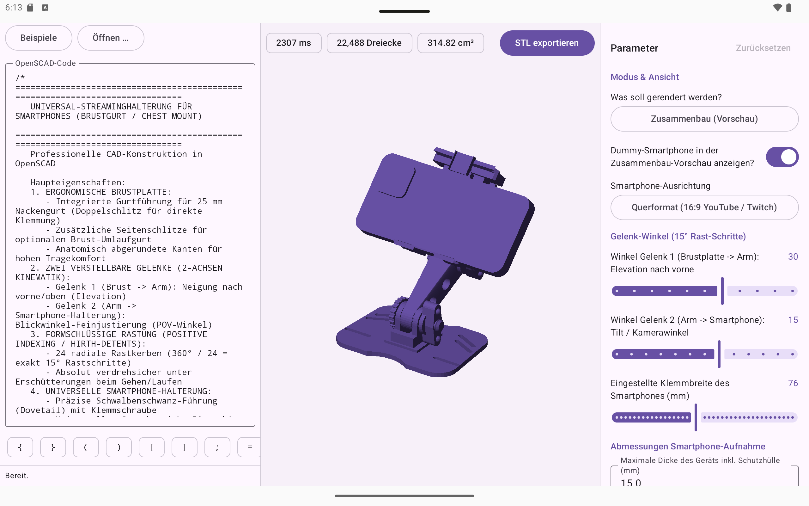
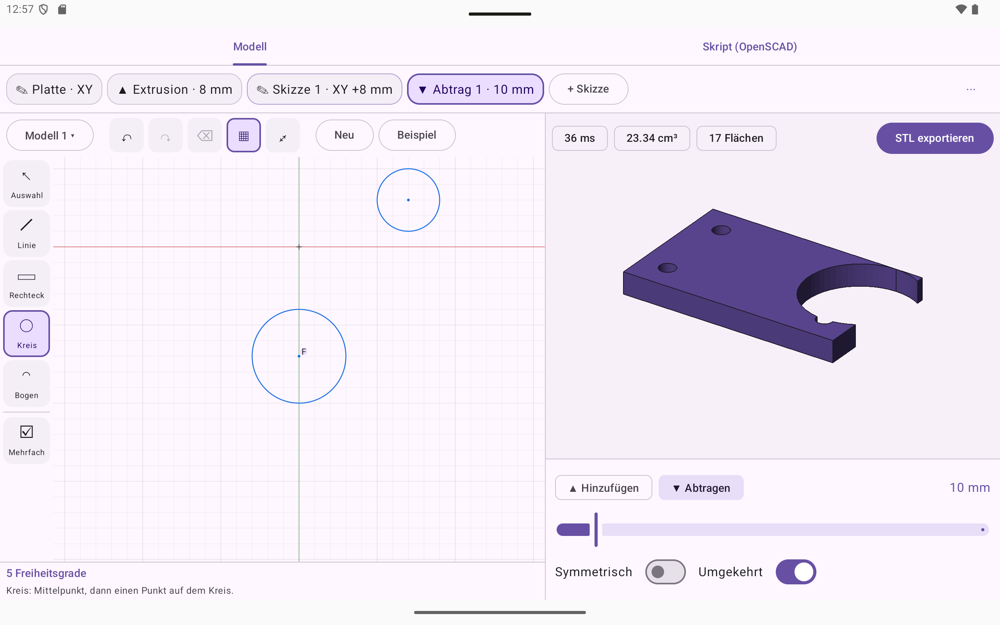
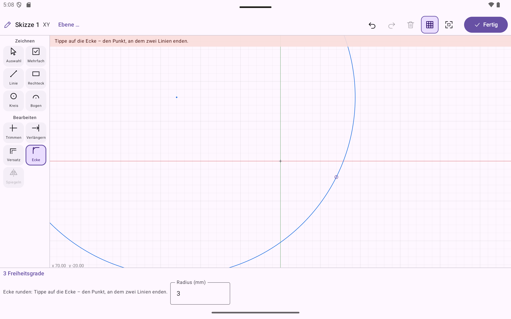
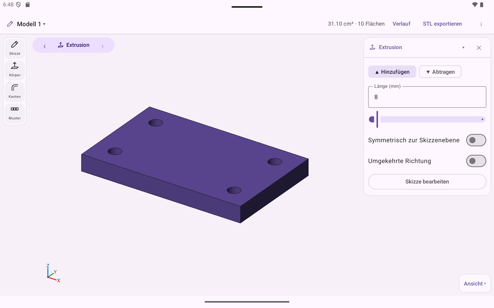
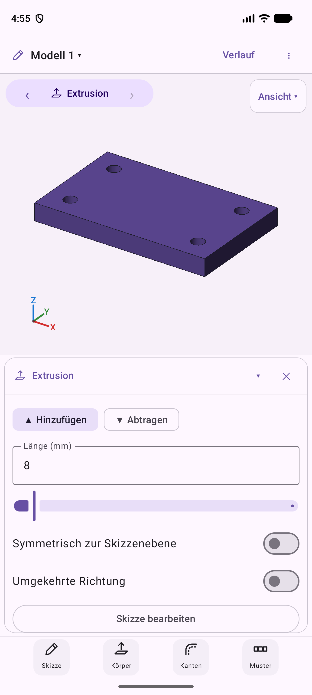
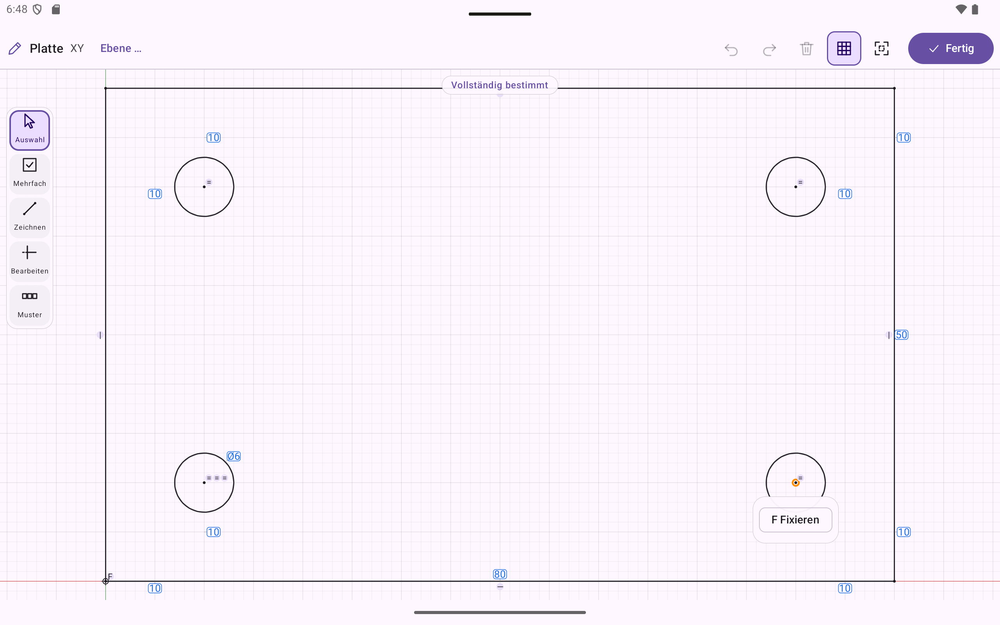
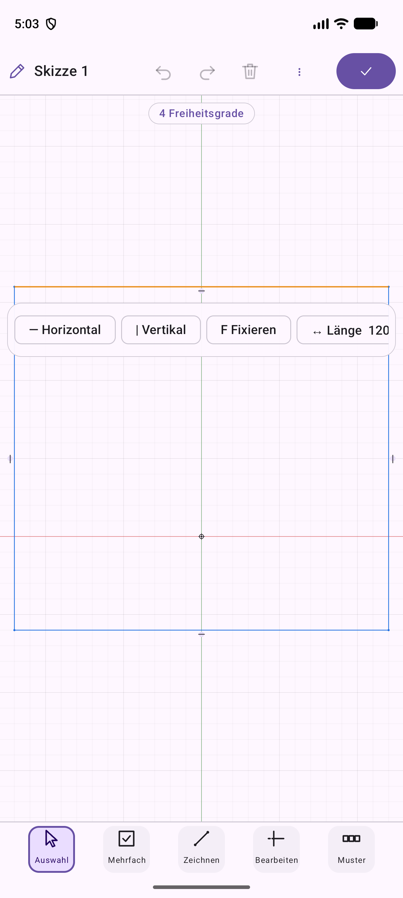

# Android CAD

Parametrische CAD-App für Android-Tablets und Googlebooks: **OpenSCAD-kompatible Skriptsprache** +
automatisch erzeugte **Customizer-Oberfläche** (Slider, Auswahl, Schalter), echte **Manifold-Geometrie**,
offline, touch- und tastaturtauglich.

Hintergrund und Entscheidungsgrundlage: `Analyse_Parametrische_CAD_App.md` im Projekt
`OpenSCAD/Streaminghalterung`. Umsetzungsstand: [docs/ROADMAP.md](docs/ROADMAP.md), Architektur:
[docs/ARCHITECTURE.md](docs/ARCHITECTURE.md).



## Produktrichtung

Parametrische CAD für **Stift und Maus**: Formen und Constraints aus Werkzeugleisten, 2D-Skizze → Extrusion/Bohrung/Verrundung,
Geometriekern **OpenCascade (B-Rep)**. Der OpenSCAD-kompatible Code-Editor bleibt als optionale Erweiterung.
Plan und Zielarchitektur: [docs/ROADMAP.md](docs/ROADMAP.md). Aktuell:
- **M0 (OpenCascade)** weitgehend abgeschlossen: `:core:brep` liefert Skizzenprofil → Körper → Netz mit Flächen-/Kanten-IDs.
- **M1 (Skizzen-Engine)**: `:core:sketch` mit Punkten, Linien, Kreisen, Bögen, 16 Constraints, 8 Bemaßungen, Solver mit
  Freiheitsgrad-Analyse, Ziehen und Regionen-Erkennung (40 JVM-Tests). Es fehlen noch Auto-Constraints und 2D-Operationen.
- **Brücke Skizze → Körper** (`:core:model`): Skizze → Region → Profil → OpenCascade-Körper, parametrisch neu aufgebaut.
- **M2 (Skizzier-Oberfläche)** läuft: Die App hat zwei Modi, die je den ganzen Bildschirm nutzen: **Skizze** (2D, mit „✓ Fertig“: Zeichenfläche vollflächig, Werkzeuggruppen wie im Modell, Status als Plakette, Bedingungen und Maße schweben direkt an der Auswahl) und **Modell** (3D: das Bild füllt den ganzen Bildschirm; Werkzeuge in vier Gruppen – Skizze, Körper, Kanten, Muster – die sich per Tipp aufklappen, auf dem Tablet links, auf dem Smartphone unten; Einstellungen erscheinen nur bei Auswahl oder laufendem Werkzeug als schwebende, einklappbare Karte bzw. auf dem Smartphone als Blatt unter dem Bild; der Modellaufbau steht als Chip „Schritt ‹ ›“ im Bild und öffnet sich auf Wunsch ganz; Standardansichten im Knopf „Ansicht“); „Fertig“ schwenkt die Kamera von der Skizzenebene in die isometrische Ansicht. Gezeichnet wird mit
  Maus, Stift oder Finger (Linie, auch tangential an Kreise; Rechteck über Ecken, vom Mittelpunkt oder aus 3 Punkten; Kreis über Mittelpunkt, 2 oder 3 Punkte oder an 2/3 Tangenten; Bogen über Mittelpunkt, 3 Punkte oder tangential als Zug; Langloch; Vieleck mit Ecken auf dem Kreis oder Seiten am Kreis (Schlüsselweite) – Variante in der Leiste unten; Fangen, Auto-Constraints); Constraints und Maße kommen aus einer kontextabhängigen
  Leiste; Ziehen hält die Bedingungen ein; „Extrudieren“ baut den Körper, der bei jeder Änderung live nachzieht.
  Skizzen und Modell werden automatisch im Projektspeicher gesichert (`model.json`) und beim Start wiederhergestellt; Projektmenü zum Wechseln, Umbenennen, Duplizieren, Löschen.
  Der **Feature-Baum** verwaltet mehrere Skizzen (Ebene XY/XZ/YZ + Versatz) und Extrusionen (Hinzufügen/Abtragen).

  **Muster und Spiegelung:** an einer Extrusion oder Bohrung „Reihe“, „Kreismuster“ oder „Spiegeln“ wählen; Anzahl, Abstand, Achse bzw. Ebene sind live einstellbar, die Kopien wirken wie das Original (hinzufügen/abtragen). Eine Reihe bekommt per Schalter eine zweite Richtung (Raster in einem Schritt) oder lässt sich erneut vervielfältigen (z. B. im Kreis); ist eine Verrundung oder Fase gewählt, entsteht das Muster ihres Features und jede Kopie bekommt die Rundung bzw. Fase mit (Schalter im Muster).
  **Körper spiegeln:** „Spiegeln“ ohne spiegelbares Feature in der Auswahl (oder „Stattdessen den ganzen Körper spiegeln“) spiegelt den ganzen bisherigen Körper an einer Koordinatenebene oder Arbeitsebene und vereinigt beide Hälften nahtlos zu einem Teil – halbes Teil zeichnen, symmetrisch ergänzen.
  **Arbeitsebenen:** „Ebene“ in der Werkzeugleiste, Fläche antippen → Ebene mit Abstand oder um eine Kante gedreht; „Skizze auf dieser Ebene“ – Ebene und Skizze folgen dem Körper.
  **Lage der Skizze:** Ursprung und X-/Y-Achse sind antippbar und lassen sich wie jede Linie in Bedingungen und Maße einbeziehen; mit einer gewählten Form setzen „Ecke auf Ursprung“ bzw. „Mittig auf Ursprung“ sie parametrisch an den Ursprung, in Skizzen auf einer Körperfläche „Mittig auf Fläche“ in die Mitte der Fläche; zusammen mit einer projizierten Bohrung bzw. Kante „Mittig auf Bohrung“ (konzentrisch) bzw. „Mittig zur Kante“ – alles bleibt mittig, wenn sich der Körper ändert. Ist nur noch die Lage frei, sagt es die Statuszeile.
  **Skizzenwerkzeuge:** Trimmen, Verlängern, Versatz, Ecke runden, Spiegeln sowie Muster (Reihe, Kreis – der Abstand bleibt als Maß änderbar, die Anzahl über „# Anzahl im Muster“ an jedem Exemplar) in der Werkzeugleiste der Skizze (Versatzabstand und Rundungsradius als Feld darunter); neue Punkte bleiben per Constraint an den Elementen, an denen sie entstanden.
  **Skizze auf Fläche:** eine Körperfläche antippen und darauf weiterzeichnen (der Umriss der Fläche erscheint als Referenz; die Skizze folgt der Fläche bei Maßänderungen). „Kanten projizieren“ legt Umriss und Bohrungen der Fläche als feste Referenz in die Skizze, an die man mit Maßen bindet – sie wandern mit dem Körper mit.
  **Verrundung/Fase/Bohrung:** Kanten bzw. Flächen im 3D-Bild antippen, Größe einstellen – die Auswahl bleibt über Maßänderungen hinweg erhalten
  ([Topological Naming](docs/TOPOLOGICAL_NAMING.md)).





 

 

Die folgende Tabelle beschreibt den bisherigen **Skript-Teil** der App (optionale Erweiterung; Skripte stehen zusammen mit den Modellen im gemeinsamen Projektmenü der App-Leiste) (Code-Editor, Customizer, Manifold).

## Stand Skript-Teil (Phase 0 – Gate A erreicht)

| Baustein | Status |
|---|---|
| Gradle-Projekt (AGP 9, Kotlin 2.3, Compose), Module `:core:lang`, `:core:geometry`, `:core:project`, `:core:sketch`, `:core:sketchedit`, `:core:brep`, `:core:model`, `:app` | ✅ |
| Sprachkern: Lexer, Parser, Evaluator → CSG-Baum (reines Kotlin/JVM) | ✅ Teilmenge, siehe unten |
| Customizer-Parser (`// [min:step:max]`, Auswahllisten, Gruppen, `Hidden`) und -UI | ✅ |
| Geometriekern: **Manifold 3.5.4** + Clipper2 per NDK/JNI (arm64-v8a + x86_64) | ✅ |
| Referenzmodell `samples/streaming_halterung.scad`: alle 8 Teile **volumengleich zu OpenSCAD** (≤ 0,013 %) | ✅ (Instrumented Test) |
| App: adaptives Layout (kompakt / mittel / erweitert), Editor, Konsole, Beispiele, „Öffnen …“ | ✅ |
| 3D-Ansicht: OpenGL ES 3 (Tiefenpuffer, Flat-Shading), Orbit/Zoom per Touch, Pinch und Mausrad | ✅ |
| **STL-Export** (binär, per Dateiauswahl) | ✅ |
| **Projekte**: mehrere benannte Projekte, **Autosave** (700 ms) + Sicherung in `onStop`, Wiederherstellung nach Neustart/Prozess-Tod, Neu / Kopie / Löschen, Import und Export von `.scad` | ✅ |
| **Undo/Redo**: Quelltext + Customizer-Werte, Tippen und Slider-Ziehen je ein Schritt, Strg+Z / Strg+Y / Strg+Umschalt+Z / Strg+S | ✅ |
| 3MF, Share-Intent, Syntax-Highlighting | ⏳ |
| `text()`, `import`, `projection`, Variablen-Hoisting wie OpenSCAD | ⏳ |

**Messwerte (Emulator Pixel Tablet, x86_64, ohne Multithreading):** komplette Zusammenbau-Ansicht der
Halterung (22 488 Dreiecke) in ≈ 0,6 s (Auswertung + Geometrie); einzelne Teile 40–130 ms.

### Unterstützte Sprachteile
Ausdrücke, Variablen, `module`/`function` (Rekursion, Standardwerte, benannte Argumente), `for`/`if`/`let`,
List-Comprehensions (`for`, `if`, `let`, `each`), Bereiche, `children()`, `$fn/$fa/$fs` (dynamisch, auch als
Aufrufargument), `include`/`use`, `echo`/`assert`, Modifier `*`; Primitive `cube sphere cylinder polyhedron circle
square polygon`; `translate rotate scale mirror multmatrix color`; `union difference intersection hull minkowski`;
`linear_extrude rotate_extrude offset`; Math-/Listenfunktionen. Polyeder werden orientierungstolerant behandelt
(wie OpenSCAD). Unbekanntes erzeugt eine Warnung statt eines Abbruchs.

**Noch offen:** `text`, `import`, `projection`, `surface`, `resize`, Modifier `#`/`%`-Darstellung, `intersection_for`,
Funktionsliterale; `rotate_extrude` nutzt noch eine feste Segmentzahl; Farben werden nicht ins Mesh übertragen.
Bekannte Abweichung: Variablen werden sequenziell zugewiesen (kein „letzte Zuweisung gilt im ganzen Scope“-Hoisting).

## Bauen & testen

Voraussetzungen: Android SDK (Plattform 36), JDK 17+ (Android-Studio-JBR genügt), **NDK 28.2.13676358** (lädt AGP selbst),
**CMake 3.31.6** im SDK (`Sdk/cmake/3.31.6`; der AGP lädt es nicht automatisch – Paket `cmake-3.31.6-windows.zip` von
dl.google.com/android/repository oder per `sdkmanager "cmake;3.31.6"`).

**OpenCascade (für `:core:brep`):** wird nicht ins Repo eingecheckt. Einmalig Quelltext holen und je ABI bauen
(≈ 25 min pro ABI auf 32 Kernen; Ergebnis nach `third_party/occt-android/<abi>`):

```powershell
git clone --depth 1 --branch V7_9_3 https://github.com/Open-Cascade-SAS/OCCT.git third_party/occt
./scripts/build-occt.ps1 -Abis x86_64,arm64-v8a
```

Zum schnellen Testen nur einer ABI: `./gradlew :core:brep:connectedDebugAndroidTest -Pandroid.injected.build.abi=x86_64`.

```bash
./gradlew :core:lang:test :core:project:test    # Sprachkern, Projektspeicher, Undo-Verlauf (JVM, schnell)
./gradlew :app:assembleDebug                    # Debug-APK
./gradlew :core:geometry:connectedDebugAndroidTest   # Manifold + OpenSCAD-Volumenvergleich (Emulator/Gerät nötig)
```

`local.properties` mit `sdk.dir=…` wird lokal angelegt (nicht eingecheckt). Die nativen Debug-Builds sind mit `-O2`
optimiert, damit Messungen aussagekräftig sind.

**Referenzdaten:** `samples/reference/*.stl` sind mit OpenSCAD 2021.01 aus der aktuellen
`samples/streaming_halterung.scad` erzeugt (Modus pro Teil, z. B. `-D 'mode="arm"'`). Bei Änderung der SCAD-Datei neu erzeugen.

## Lizenzen
Der Sprachkern ist eine **eigene Implementierung** (kein OpenSCAD-Code, kein CGAL) – bewusst, um die GPL nicht auf die App
auszudehnen. Eingebunden in `third_party/`: [Manifold](https://github.com/elalish/manifold) (Apache 2.0) und
[Clipper2](https://github.com/AngusJohnson/Clipper2) (Boost Software License).
