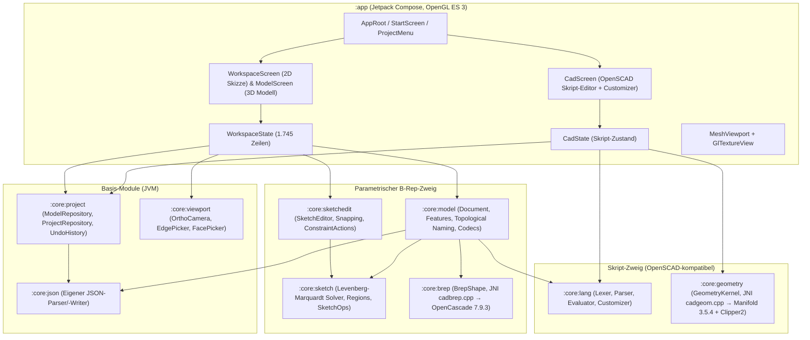

# Gesamtprojekt-Analyse, Technische Schwachstellen & Lizenzrechtliche Gefahrenanalyse (`ParamWorker` / `Android-CAD`)

**Stand:** 19.10.2026  
**App-Kennung:** `io.github.kevbo8327.paramworker`  
**Interner Namespace:** `dev.androidcad.*`

---

## Teil 1: Gesamtprojekt-Analyse (Architektur & Reifegrad)

### 1.1 Modulstruktur & Datenfluss

Das Projekt gliedert sich in **9 Kernmodule** (`:core:*`) und ein **Android-UI-Modul** (`:app`). Sechs der Kernmodule (`:core:lang`, `:core:json`, `:core:project`, `:core:sketch`, `:core:sketchedit`, `:core:viewport`) sind reine Kotlin/JVM-Bibliotheken ohne Android-Abhängigkeit, während `:core:brep`, `:core:geometry` und `:core:model` Android- bzw. JNI-gebunden sind:

### 1.2 Architektonische Stärken
1. **Entkopplung der 2D-Skizzierlogik vom UI-Framework:** `SketchEditor` (`core/sketchedit/src/main/kotlin/dev/androidcad/sketchedit/SketchEditor.kt`) ist komplett frei von Android- und Compose-Abhängigkeiten und wird über simulierte Zeigerereignisse (`PointerKind.TOUCH`, `STYLUS`, `MOUSE`) direkt auf der JVM getestet.
2. **Saubere Clean-Room-Implementierungen zur GPL-Vermeidung:** Sowohl der 2D-Constraint-Solver (`:core:sketch`) als auch der OpenSCAD-kompatible Sprachkern (`:core:lang`) wurden eigenständig in Kotlin geschrieben, um GPL-Abhängigkeiten wie `SolveSpace`, `OpenSCAD` oder `CGAL` zu vermeiden.
3. **Robuste Dateipersistenz:** `AtomicFiles.kt` und `ModelRepository.kt` schreiben Änderungen zunächst in `.tmp`-Dateien, synchronisieren den Dateideskriptor und legen `.bak`-Sicherungen an. Beschädigte Dateien werden beim Start nicht blind überschrieben.
4. **Moderne Android-Toolchain & 16-KB-Seitengröße:** Alle 62 nativen `.so`-Bibliotheken (für `arm64-v8a` und `x86_64`) sind mit `max-page-size=16384` für Android 15/16 gebaut.

---

## Teil 2: Detaillierte Liste technischer & architektonischer Schwachpunkte

### 2.1 Übersicht nach Kritikalität

| ID | Schweregrad | Bereich | Kurzbeschreibung |
|---|---|---|---|
| **T-01** | 🔴 **KRITISCH** | `:core:model` | **Bit-Packing-Kollision in `FaceRef`:** 99,997 % aller Innenflächen von `ShellFeature` verlieren bei `MirrorBodyFeature` ihren Namen (`0L`) oder werfen `IllegalArgumentException`. |
| **T-02** | 🟠 **HOCH** | `:core:brep` | **`edgeFaceTags` ignoriert `faceAliases`:** Nach `unifyFaces()` (Booleans/Spiegeln) schlagen `edgesBetween()` (Verrundung) und `EdgeProjection` für verschmolzene Flächen fehl. |
| **T-03** | 🟠 **HOCH** | `:core:brep` / `:app` | **Race Condition & `finalize()` in `BrepShape`:** Nicht-synchronisiertes `closed`-Flag zwischen UI-Thread und Hintergrund-Rebuild; native Speicherverwaltung hängt am JVM-GC. |
| **T-04** | 🟠 **HOCH** | `:core:brep` / `:core:geometry` | **Fehlende Null-Checks bei JNI-Allokationen:** `New*Array` und `GetStringUTFChars` ohne `nullptr`-Prüfung führen bei Speicherdruck zu hartem `SIGSEGV` statt `OutOfMemoryError`. |
| **T-05** | 🟠 **HOCH** | `:core:sketch` | **Nicht-glatte Residuen & Sprungstellen im Solver:** `TangentLineRound` nutzt `abs(...)` (Seitenwechsel/Knick bei 0), `AngleDim` springt bei $\pm\pi$ (Finite-Differenzen-Explosion $\approx 3\cdot 10^6$), Einheiten-Mismatch (mm vs. rad). |
| **T-06** | 🟠 **HOCH** | `:core:sketch` / `:core:sketchedit` | **$O(n^3)$ Jacobi-Eigenwertzerlegung auf $J^T J$ & 3-faches Neu-Lösen im UI-Thread:** Quadrierte Konditionszahl $\kappa(J)^2$; `statusText()` ruft `placementFreedom()` (3 komplette Solver-Läufe!) während der Compose-Rekomposition auf. |
| **T-07** | 🟠 **HOCH** | `:core:sketch` | **Regionen-Erkennung (`Regions.kt`) scheitert an geteilten Kanten & T-Stößen:** Jede Verzweigung (`Grad != 2`) verwirft die gesamte Komponente; dünne konzentrische Ringe scheitern am 64-Eck-Test. |
| **T-08** | 🟠 **HOCH** | `:app` | **Slider-Ziehen flutet `UndoHistory` & serialisiert JSON synchron im UI-Thread:** `markDirty()` ruft bei jedem Slider-Tick `DocumentCodec.encode(doc)` im Main-Thread auf und überschreibt alle 50 Undo-Schritte. |
| **T-09** | 🟠 **HOCH** | `:core:model` | **Kompletter Historien-Neuaufbau (`O(N)`) ohne Zwischen-Cache:** Jede Maßänderung baut alle Features ab Schritt 1 inkl. `ShapeUpgrade_UnifySameDomain` neu auf. |
| **T-10** | 🟠 **HOCH** | `:core:model` / `:app` | **Kaskadierendes Löschen in `Document.remove()` ohne Vorwarnung:** Löschen eines Features löscht stillschweigend alle transitiv abhängigen Features; der Warndialog zählt nur direkte Extrusionen/Drehungen einer Skizze. |
| **T-11** | 🟡 **MITTEL-HOCH** | `:core:model` / `:app` | **Unvollständige Parameter-Bindung & Dezimalkomma-Bug:** `applyParameters()` und `WorkspaceState.evaluate()` vergessen `decimalComma()`; Bohrungen, Muster und Arbeitsebenen unterstützen keine Parameter/Ausdrücke. |
| **T-12** | 🟡 **MITTEL-HOCH** | `:core:brep` | **Naive UV-Mittelpunkt-Heuristik in `shell()`:** `s.Value(0.5*(u0+u1), 0.5*(v0+v1))` liegt bei getrimmten/gelochten Flächen oft außerhalb der Fläche und ordnet Innenflächen falsch zu. |
| **T-13** | 🟡 **MITTEL-HOCH** | `:core:brep` / `:app` | **Thread-Sicherheit von OpenCascade & synchrone JNI-Aufrufe im UI-Thread:** `STEPControl_Writer` ist nicht thread-sicher; `translate(0,0,0)` teilt `TopoDS_TShape`; `distance()`/`faceArea()` blockieren den UI-Thread. |
| **T-14** | 🟡 **MITTEL-HOCH** | `:app` | **Synchrones Datei-I/O + Lock in `MainActivity.onStop()` (ANR-Risiko):** `hub.flush()` wartet im Main-Thread auf `saveLock` und schreibt synchron Backup-, Modell- und Metadaten-Dateien. |
| **T-15** | 🟡 **MITTEL** | `:core:geometry` / `:core:brep` | **Integer-Überlauf & unbegrenzte Tessellierung in JNI:** Vorzeichenbehaftete `jint` werden ohne `< 0`-Prüfung in `size_t` gecastet; `BRepMesh_IncrementalMesh` hat kein Dreieckslimit. |
| **T-16** | 🟡 **MITTEL** | `:app` | **OpenGL-Shader-Leak, UI-Thread-Raycasting & unbehandelter EGL-Crash:** `MeshRenderer.link()` löscht Shader nicht; jeder Tipp berechnet `SceneFrame.of` + Dreiecks-Strahltest im UI-Thread; `GlThread` crasht bei transientem Surface-Fehler. |
| **T-17** | 🟡 **MITTEL** | `:core:model` | **In-Place-Mutation während `Document.build()`:** `build()` verändert `SketchFeature` und `HoleFeature` in-place und erfordert fehleranfälliges `adoptResolvedFrom(copy)`. |
| **T-18** | 🟡 **MITTEL** | `:app` / `:core:sketchedit` | **Monolithische „God-Classes“:** `SketchEditor.kt` (1.779 Zeilen / 91 KB), `Workspace.kt` (1.745 Zeilen / 82 KB), `FeatureBar.kt` (52 KB), `SketchOps.kt` (1.003 Zeilen / 58 KB). |
| **T-19** | 🟢 **NIEDRIG-MITTEL** | `:core:json` / `:core:model` | **53-Bit-Präzisionslimit in `Json.kt` & fehlende Aufwärtskompatibilität:** `JsonValue.Num` speichert alles als `Double`; `DocumentCodec` bricht bei unbekannten Features hart ab. |
| **T-20** | 🟢 **NIEDRIG-MITTEL** | Build / CI / I18n | **Fehlende native Tests in GitHub Actions, Debug-Signatur-Fallback, leere ProGuard-Regeln, hartcodierte deutsche Strings.** |

---

### 2.2 Detailbeschreibungen & Behebungsvorschläge (Technik)

#### T-01 (KRITISCH): Bit-Packing-Kollision zwischen `ShellFeature`, `MirrorNaming` und `PatternGeometry`
- **Dateien & Zeilen:**
  - `core/model/src/main/kotlin/dev/androidcad/model/FaceRef.kt:29–52`
  - `core/model/src/main/kotlin/dev/androidcad/model/Features.kt:204`
  - `core/model/src/main/kotlin/dev/androidcad/model/MirrorBody.kt:11–30`
  - `core/model/src/main/kotlin/dev/androidcad/model/PatternGeometry.kt:107–140`
  - `core/model/src/main/kotlin/dev/androidcad/model/Document.kt:318`
- **Ursache:**
  `FaceRef` kodiert Referenzen als `(feature [15 Bit] shl 48) or (role [8 Bit] shl 40) or element [40 Bit]`. Drei Subsysteme treffen jedoch inkompatible Annahmen über die Belegung der 40 `element`-Bits:
  1. `ShellFeature.innerElement(outerTag: Long)` (`Features.kt:204`) berechnet `(outerTag * -0x61c8864680b583ebL) ushr 24` und erzeugt damit einen vollen **40-Bit-Streuwert** (`0 .. 2^40 - 1`).
  2. `MirrorNaming` (`MirrorBody.kt:12–25`) setzt voraus, dass `original.element < 2^25` (`ELEMENT_LIMIT = 1L shl 25`) gilt, um `(original.feature shl 25) or original.element` in 40 Bit zu packen. In `mirrorTag(tag, owner)` (`MirrorBody.kt:18`) gibt die Funktion bei `ref.element >= 2^25` stillschweigend `0L` (unbenannt) zurück. Da `ShellFeature.innerElement` gleichmäßig über 40 Bit streut, haben **99,997 % ($1 - 2^{-15}$) aller Innenflächen einer Schale ein `element >= 2^25` und verlieren beim Spiegeln des Körpers (`MirrorBodyFeature`) ihren topologischen Namen komplett!**
  3. Wird `MirrorNaming.mirroredElement(original)` (`MirrorBody.kt:24`) oder `PatternGeometry.copyTag` (`PatternGeometry.kt:109`, `BASE_LIMIT = 1L shl 20`) auf solchen Elementen aufgerufen, fliegt eine ungefangene `IllegalArgumentException`.
- **Behebung:**
  `ShellFeature.innerElement` auf kleine deterministische Indizes oder `< 2^20` begrenzen bzw. die ad-hoc Bit-Aufteilung des 40-Bit-Feldes durch eine kanonische Tag-Tabelle (`FacePath` ↔ `Long`) ersetzen.

#### T-02 (HOCH): `edgeFaceTags` ignoriert `faceAliases` nach `unifyFaces()`
- **Dateien & Zeilen:**
  - `core/brep/src/main/cpp/cadbrep.cpp:635–680, 860–886`
  - `core/brep/src/main/kotlin/dev/androidcad/brep/BrepShape.kt:238–266`
  - `core/model/src/main/kotlin/dev/androidcad/model/EdgeProjection.kt:34`
- **Ursache:**
  Wenn `unifyFaces()` (`ShapeUpgrade_UnifySameDomain`) nach Booleans (`Document.kt:752`) oder `MirrorBodyFeature` (`Document.kt:726`) komplanare Flächen zusammenführt, wird ein Tag als Primär-Tag in `out.faceTags` gespeichert und alle weiteren Namen der verschmolzenen Flächen landen in `out.faceAliases` (`cadbrep.cpp:670–672`).
  Während `facesWithTag(tag)` beide Listen prüft (`BrepShape.kt:129–139`), gibt `Java_dev_androidcad_brep_NativeBrep_edgeFaceTags` (`cadbrep.cpp:860–886`) **nur den einzelnen Primär-Tag `e.faceTags[fi - 1]`** zurück und ignoriert `e.faceAliases` vollständig.
- **Auswirkung:**
  1. `BrepShape.edgesBetween(tagA, tagB)` (`BrepShape.kt:258–266`) findet keine Kanten mehr, wenn `tagA` oder `tagB` in `faceAliases` liegt (Verrundungen/Fasen verlieren ihre Kanten nach Maßänderungen).
  2. `EdgeProjection.collect(body, faceTag, plane)` (`EdgeProjection.kt:34`) überspringt Randkanten einer vereinigten Fläche, deren Nachbar-Tag in `faceAliases` liegt.
  3. Interaktives Kanten-Picking (`Workspace.kt:1671`) und Bohrungs-Referenzkanten (`Workspace.kt:1460`) sehen nur den Primär-Tag.
- **Behebung:**
  `edgeFaceTags` in `cadbrep.cpp` so erweitern, dass für jede angrenzende Fläche `fi` auch alle Alias-Tags aus `e.faceAliases[fi - 1]` geliefert werden, oder `edgesBetween(tagA, tagB)` über die Flächenindizes `facesWithTag(tagA)` und `facesWithTag(tagB)` auflösen.

#### T-03 (HOCH): Race Condition & `finalize()` im `BrepShape`-Lifecycle
- **Dateien & Zeilen:**
  - `core/brep/src/main/kotlin/dev/androidcad/brep/BrepShape.kt:90–93, 281–300`
  - `core/brep/src/main/cpp/cadbrep.cpp:54–65, 890–894`
  - `app/src/main/kotlin/dev/androidcad/app/Workspace.kt:1203, 1363, 1369, 1445, 1617`
- **Ursache:**
  - `BrepShape.closed` ist ein einfaches `Boolean` ohne `@Volatile` oder Synchronisation zwischen `call { check(!closed); ... }` und `close()`.
  - Zwischen-Shapes in `Document.build()` werden nicht deterministisch per `.close()` geschlossen, sondern erst über das seit Java 9 veraltete `finalize()` (`BrepShape.kt:289`) freigegeben. Da die Kotlin-Hülle winzig ist, die nativen OCCT-Strukturen (`TopoDS_Shape` + `Poly_Triangulation`) aber mehrere Megabyte im C++-Heap belegen, kann schnelles Slider-Ziehen den nativen Speicher erschöpfen, bevor der JVM-GC läuft.
- **Behebung:**
  - `closed` und JNI-Aufrufe in `BrepShape` thread-sicher synchronisieren (`ReentrantReadWriteLock` oder Referenzzähler).
  - `finalize()` durch `java.lang.ref.Cleaner` ersetzen und temporäre `BrepShape`-Objekte in `Document.build()` sofort schließen.

#### T-04 (HOCH): Fehlende Null-Checks bei JNI-Array- und String-Allokationen (`SIGSEGV`)
- **Dateien & Zeilen:**
  - `core/brep/src/main/cpp/cadbrep.cpp:261–275, 586–596, 702–704, 812–820, 849–855, 883–885`
  - `core/geometry/src/main/cpp/cadgeom.cpp:349–370`
- **Ursache:**
  Aufrufe wie `env->NewFloatArray(...)`, `env->NewIntArray(...)`, `env->NewDoubleArray(...)`, `env->NewObjectArray(...)` und `env->GetStringUTFChars(path, nullptr)` (`cadbrep.cpp:702`) werden ohne Prüfung auf `nullptr` verwendet. Bei knappen Heap-Ressourcen liefert JNI `nullptr` zurück; der anschließende Aufruf von `std::string(nullptr)` oder `env->Set*ArrayRegion(nullptr, ...)` führt sofort zu einem harten nativen Absturz (`SIGSEGV`).
- **Behebung:**
  Nach jeder JNI-Allokation `if (!ptr) return nullptr;` prüfen.

#### T-05 (HOCH): Nicht-glatte Residuen & Sprungstellen im Skizzen-Solver (`Compile.kt` & `Solver.kt`)
- **Dateien & Zeilen:**
  - `core/sketch/src/main/kotlin/dev/androidcad/sketch/Compile.kt:218–221, 313–322`
  - `core/sketch/src/main/kotlin/dev/androidcad/sketch/Solver.kt:50–61`
- **Ursache:**
  1. **`TangentLineRound` (`Compile.kt:219`):** Nutzt `val dist = abs(dx * (x[r.cy] - x[ay]) - dy * (x[r.cx] - x[ax])) / max(hypot(dx, dy), EPS)`. Am Nulldurchgang (`dist = 0`, Kreismittelpunkt überschreitet die Gerade) hat `abs` einen Knick (unstetige Ableitung $\pm 1$), und da das Vorzeichen der Halbebene nicht festgehalten wird, kann der Kreis bei größeren Solver-Schritten auf die falsche Seite der Linie springen.
  2. **`AngleDim` (`Compile.kt:320`):** Nutzt `wrapAngle(atan2(...) - target)`. Nahe der Sprungstelle $\pm\pi$ liegen `x + h` und `x - h` in `jacobianBlock` auf unterschiedlichen Seiten des $2\pi$-Umschlags, was eine fiktive zentrale Differenz von $\pm \frac{\pi}{h} \approx \pm 3{,}14 \times 10^6$ erzeugt.
  3. **Einheiten-Skalierung:** `AngleDim` gibt Residuen in Radiant ($\sim 10^{-2}$) zurück, Längenmaße in Millimetern ($\sim 10^2$).
- **Behebung:**
  Winkeldifferenzen in `jacobianBlock` relativ zum ungestörten Residuum entpacken (oder über `sin`/`cos` formulieren) und mit einer charakteristischen Länge gewichten; analytische Ableitungen für die Standard-Constraints ergänzen.

#### T-06 (HOCH): Dense $O(n^3)$ `jacobiEigen` auf $J^T J$ & 3-faches Neu-Lösen auf dem UI-Thread in `statusText()`
- **Dateien & Zeilen:**
  - `core/sketch/src/main/kotlin/dev/androidcad/sketch/Solver.kt:118–137, 186–252`
  - `core/sketch/src/main/kotlin/dev/androidcad/sketch/LinearAlgebra.kt:10–81`
  - `core/sketch/src/main/kotlin/dev/androidcad/sketch/SketchOps.kt:672–690`
  - `core/sketchedit/src/main/kotlin/dev/androidcad/sketchedit/SketchEditor.kt:1708, 1733`
- **Ursache:**
  1. `Solver.analyze()` bildet $A = J^T J$ und berechnet die Eigenwerte über bis zu 60 volle Jacobi-Sweeps (`jacobiEigen`, $O(n^3)$). Das Bilden von $J^T J$ quadriert die Konditionszahl ($\kappa(J^T J) = \kappa(J)^2$).
  2. Jedes Mal, wenn Compose die Status-Plakette (`StatusPill` in `WorkspaceScreen.kt:297`) zeichnet und `dof in 1..3` ist, ruft `SketchEditor.statusText()` `sketch.placementFreedom()` auf (`SketchOps.kt:672–690`). Diese Funktion **klont die gesamte Skizze bis zu 3-mal und führt 3 komplette `Solver.solve()`-Durchläufe (inklusive LM + `jacobiEigen` + Gram-Schmidt!) synchron auf dem UI-Thread aus!**
- **Behebung:**
  - `jacobiEigen(J^T J)` + Gram-Schmidt durch eine spaltenpivotierte Householder-QR-Zerlegung direkt auf $J$ ersetzen ($\sim 50\times$ schneller, keine Quadrierung der Konditionszahl).
  - `placementFreedom` direkt aus dem bereits in `analyze()` berechneten Nullraum von $J$ per Skalarprodukt mit den 3 Starrkörper-Moden $(t_x, t_y, r_\theta)$ in $O(n)$ berechnen und `statusText()` pro Solver-Lauf cachen.

#### T-07 (HOCH): `Regions.kt` scheitert an geteilten Kanten, T-Stößen und dünnen Ringen
- **Dateien & Zeilen:**
  - `core/sketch/src/main/kotlin/dev/androidcad/sketch/Regions.kt:70–159, 196–240`
- **Ursache:**
  1. `findWithDiagnostics` verwirft jede Zusammenhangskomponente komplett (`"Verzweigung bei ..."`), sobald auch nur ein einziger Knoten einen Grad $\ne 2$ hat (`Regions.kt:124`). Zwei aneinanderliegende Rechtecke mit gemeinsamer Mittelwand oder eine Hilfslinie ohne Konstruktionsflag führen dazu, dass gar keine Region erkannt wird.
  2. `contains(outer, inner)` (`Regions.kt:196, 240`) tastet Kreise/Bögen als 64-Eck ab und prüft nur den einzelnen Punkt `inner[0]`. Bei sehr dünnen konzentrischen Ringen ($r > R \cos(\pi/64) \approx 0{,}9988 R$) schlägt die Loch-Zuordnung fehl.
- **Behebung:**
  Planare Halbkanten-Zerlegung (DCEL / „Next-Leftmost-Turn“-Winkel-Walking per `atan2`) implementieren, um bei Verzweigungen alle elementaren geschlossenen Teilflächen zu finden.

#### T-08 (HOCH): Slider-Ziehen flutet `UndoHistory` und serialisiert JSON synchron im UI-Thread
- **Dateien & Zeilen:**
  - `app/src/main/kotlin/dev/androidcad/app/Workspace.kt:55–79, 422–444`
  - `app/src/main/kotlin/dev/androidcad/app/FeatureBar.kt:388, 404, 415, 440, 473, 639, 810, 816`
- **Ursache:**
  `WorkspaceState.markDirty()` (`Workspace.kt:430`) ruft bei jeder Änderung synchron auf dem **UI-Thread** `DocumentCodec.encode(doc)` auf und schiebt den kompletten JSON-String in `Workspace.UndoHistory` (max. 50 Einträge, ohne Zeitfenster-Zusammenfassung). Beim Ziehen eines Sliders in `FeatureBar.kt` wird `markDirty()` bis zu 60-mal pro Sekunde ausgelöst — das kostet Main-Thread-Framezeit und überschreibt alle 50 Undo-Schritte mit winzigen Zwischenwerten einer einzigen Slider-Bewegung.
- **Behebung:**
  Während `editing == true` bzw. während einer laufenden Slider-Bewegung (`onValueChange`) keine neuen Zwischenstände in `UndoHistory` ablegen (oder Zeitfenster-Coalescing wie in `:core:project:UndoHistory` nutzen) und `DocumentCodec.encode(doc)` für Autosave auf den `saveDispatcher` verlagern.

#### T-09 (HOCH): Kompletter Historien-Neuaufbau (`O(N)`) ohne Zwischen-Cache
- **Dateien & Zeilen:**
  - `core/model/src/main/kotlin/dev/androidcad/model/Document.kt:428–754`
- **Ursache:**
  `Document.build()` berechnet bei jeder Änderung alle Skizzen und alle OpenCascade-Features ab Schritt 1 komplett neu und führt nach jedem einzelnen Boolean `unifyFaces()` (`ShapeUpgrade_UnifySameDomain`) aus (`Document.kt:752`).
- **Behebung:**
  Zwischenstände (`BrepShape`-Klone + aufgelöste Ebenen/Skizzen) pro Feature-Schritt cachen und bei Änderungen an Feature $k$ den gecachten Zustand von Schritt $k-1$ wiederverwenden.

#### T-10 (HOCH): Kaskadierendes Löschen in `Document.remove()` ohne vollständige Warnung
- **Dateien & Zeilen:**
  - `core/model/src/main/kotlin/dev/androidcad/model/Document.kt:396–419`
  - `app/src/main/kotlin/dev/androidcad/app/FeatureBar.kt:205–212`
- **Ursache:**
  `Document.remove(id)` löscht transitiv alle abhängigen Folge-Features, aber der Bestätigungsdialog in `FeatureBar.kt:205` zählt nur direkte Extrusionen/Drehungen einer Skizze (`if (f is SketchFeature) ... else 0`). Beim Löschen einer Extrusion oder Arbeitsebene wird der Nutzer nicht gewarnt, welche abhängigen Skizzen, Bohrungen, Muster oder Spiegelungen mitgelöscht werden.
- **Behebung:**
  Im Dialog die exakte transitive Löschmenge ausweisen; perspektivisch abhängige Features im Baum belassen und als „Referenz fehlt“ markieren.

#### T-11 (MITTEL-HOCH): Dezimalkomma-Bug in Formel-Feldern & fehlende Parameter-Unterstützung
- **Dateien & Zeilen:**
  - `core/model/src/main/kotlin/dev/androidcad/model/Parameters.kt:20–71`
  - `core/model/src/main/kotlin/dev/androidcad/model/Document.kt:105`
  - `app/src/main/kotlin/dev/androidcad/app/Workspace.kt:1298`
- **Ursache:**
  1. `evaluateParameters()` wandelt Dezimalkommas (`1,5` → `1.5`) über `decimalComma()` um, aber `Document.applyParameters()` (`Document.kt:105`) und `WorkspaceState.evaluate()` (`Workspace.kt:1298`) rufen `CadLang.evalNumber(...)` **ohne** `decimalComma()` auf. Dadurch scheitern Ausdrücke wie `wand * 1,5` in Maß- und Feature-Feldern.
  2. `HoleFeature`, `PatternFeature` und `PlaneFeature` sind in `ValueRef` / `applyValue` (`Parameters.kt:26–68`) nicht angebunden und können keine Parameter nutzen.
- **Behebung:**
  `decimalComma()` zentral vor `CadLang.evalNumber()` aufrufen und `ValueRef` um Bohrungs-, Muster- und Ebenen-Parameter erweitern.

#### T-12 (MITTEL-HOCH): Naive UV-Mittelpunkt-Heuristik in `shell()`
- **Dateien & Zeilen:**
  - `core/brep/src/main/cpp/cadbrep.cpp:508–526`
- **Ursache:**
  Für Innenflächen von `BRepOffsetAPI_MakeThickSolid` berechnet `shell()` den UV-Parameter-Mittelpunkt `s.Value(0.5 * (u0 + u1), 0.5 * (v0 + v1))` und sucht per `BRepExtrema_DistShapeShape` die nächstgelegene alte Fläche. Bei getrimmten Flächen, L-Flächen oder Flächen mit Bohrungen liegt dieser UV-Punkt oft außerhalb der Fläche oder näher an einer Nachbarwand.
- **Behebung:**
  Zuerst rückwärts über alle `oldFaces` prüfen, für welche `oldFace` `maker.Generated(oldFace)` die neue Fläche enthält (exakte OCCT-Historie in $O(F_{\text{old}})$).

#### T-13 (MITTEL-HOCH): Thread-Sicherheit von OpenCascade & synchrone JNI-Aufrufe im UI-Thread
- **Dateien & Zeilen:**
  - `core/brep/src/main/cpp/cadbrep.cpp:322, 705–709`
  - `app/src/main/kotlin/dev/androidcad/app/ModelScreen.kt:187–192`
  - `app/src/main/kotlin/dev/androidcad/app/Workspace.kt:1363, 1369, 1445, 1617`
- **Ursache:**
  - `STEPControl_Writer` (`cadbrep.cpp:705`) verändert globale `Interface_Static`-Werte in OCCT und ist nicht thread-sicher. Zudem klont `it.translate(0.0, 0.0, 0.0)` (`ModelScreen.kt:187`) die zugrundeliegende `TopoDS_TShape` nicht tief (`Copy = Standard_False` in `cadbrep.cpp:322`).
  - `body.distance()`, `body.faceArea()`, `body.planarFaces()` und `body.edges()` werden beim Messen und Flächen-Picking synchron auf dem UI-Thread aufgerufen.
- **Behebung:**
  `writeStep` in C++ mit einem Mutex schützen, für den Export eine echte Kopie (`BRepBuilderAPI_Copy`) anlegen und `distance()`/`faceArea()` in eine Hintergrund-Coroutine verlagern.

#### T-14 (MITTEL-HOCH): Synchrones Datei-I/O + Lock in `MainActivity.onStop()` (ANR-Risiko)
- **Dateien & Zeilen:**
  - `app/src/main/kotlin/dev/androidcad/app/MainActivity.kt:55–57`
  - `app/src/main/kotlin/dev/androidcad/app/Workspace.kt:460–473`
  - `app/src/main/kotlin/dev/androidcad/app/CadState.kt:238–249`
- **Ursache:**
  `MainActivity.onStop()` ruft `hub.flush()` synchron auf dem Main-Thread auf, wartet dort auf `synchronized(saveLock)` (falls gerade ein Hintergrund-Save inkl. Thumbnail-Rendering läuft) und führt anschließend mehrere synchrone Dateioperationen (`fsync`, `.bak`-Kopie, `.tmp`-Rename) auf dem Main-Thread aus.
- **Behebung:**
  Im Main-Thread in `onStop()` nur den aktuellen Snapshot/String erfassen und das eigentliche Schreiben an einen prozessweiten `saveDispatcher`-Scope übergeben.

#### T-15 bis T-20 (Weitere technische Punkte)
- **T-15 (`cadgeom.cpp:179–205`, `cadbrep.cpp:770–821`):** Vorzeichenbehaftete `jint`-Werte aus dem Bytecode (`nextInt()`) vor dem Cast in `size_t` auf `>= 0` und Obergrenzen prüfen; Dreiecksanzahl in `tessellate` begrenzen.
- **T-16 (`MeshViewport.kt:238–244, 323–341`, `GlTextureView.kt:116`):** `glDetachShader` + `glDeleteShader` nach `glLinkProgram` aufrufen; `SceneFrame` im `TriangleMesh` vorberechnen statt bei jedem Tap im UI-Thread alle Vertices zu durchlaufen; in `GlThread.run()` bei transienten Surface-Fehlern nicht mit ungefangener `IllegalStateException` abstürzen.
- **T-17 (`Document.kt:452–455, 620–621`, `Workspace.kt:1208`):** `Document.build()` mutiert `SketchFeature` und `HoleFeature` in-place und erfordert `adoptResolvedFrom(copy)`. Besser alle abgeleiteten Werte rein über `Document.Output` zurückgeben.
- **T-18 (`SketchEditor.kt`, `Workspace.kt`, `FeatureBar.kt`, `SketchOps.kt`):** Aufteilung der 80–90 KB großen Monolithen in kleinere, fachlich geschnittene Klassen (`ToolHandler`-Hierarchie in `:core:sketchedit`, eigene Picking-/Build-/Persistenz-Controller in `:app`).
- **T-19 (`Json.kt:41, 52`, `DocumentCodec.kt:59, 258`):** `JsonValue.Num` verliert bei 64-Bit-Ganzzahlen $> 2^{53}$ durch Speicherung als `Double` an Genauigkeit; unbekannte JSON-Felder/Features sollten beim Laden fehlertolerant behandelt werden.
- **T-20 (`.github/workflows/ci.yml`, `app/build.gradle.kts:28`, `app/proguard-rules.pro`):** Native B-Rep-/Manifold-Tests in CI ergänzen; explizite `-keep`-Regeln für `NativeBrep` und `NativeGeom` in `proguard-rules.pro` hinterlegen; Release-Task bei fehlendem Upload-Keystore im CI/Release-Modus warnen bzw. fehlschlagen lassen.

---

## Teil 3: Lizenzrechtliche & Regulatorische Gefahrenanalyse

> [!IMPORTANT]
> **Hinweis:** Die folgende Analyse dokumentiert die Ergebnisse einer technischen und lizenzrechtlichen Prüfung (Software Composition & Compliance Audit) anhand des Quellcodes, der Binärartefakte (`app-release.apk`) und der Lizenztexte. Sie ersetzt im Einzelfall keine Rechtsberatung durch eine Fachanwältin oder einen Fachanwalt für IT-/Urheberrecht.

### 3.1 Übersicht der identifizierten Risiken

| ID | Risiko-Stufe | Komponente / Rechtsgebiet | Gefährdung / Verstoß |
|---|---|---|---|
| **L-01** | 🔴 **KRITISCH** | DSGVO Art. 13 & Google Play Policy | **Platzhalter `[NAME]`, `[ANSCHRIFT]`, `[E-MAIL-ADRESSE]` in `docs/privacy/index.html:31, 79`** sowie fehlende Erwähnung der E-Mail-Verarbeitung bei „Feedback senden“ (`kb-it-services@outlook.de`). |
| **L-02** | 🔴 **KRITISCH** | § 5 DDG (Impressumspflicht) & UWG | **Kein Impressum innerhalb der Offline-App:** Da die App komplett offline arbeitet, ist eine Anbieterkennzeichnung nach § 5 DDG in der App (`ProjectMenu.kt`) überhaupt nicht vorhanden (akute Abmahngefahr in Deutschland!). |
| **L-03** | 🟠 **HOCH** | LGPL 2.1 § 6 (`Open CASCADE 7.9.3`) | **Fehleinschätzung von LGPL 2.1 § 6(b) bei Android-APKs & unvollständiges § 6(c)-Angebot in `LicensesDialog.kt:43–47`:** Die OCCT-Exception gilt nur für Header (§ 5), nicht für § 6. Mitgelieferte `.so`-Dateien im signierten APK erfüllen § 6(b)(1) nicht allein; für § 6(a)/(c)/(d) fehlen das Relinking-Kit (`cadbrep.cpp`/`.o` + Repackaging-Anleitung) und die ausdrückliche Reverse-Engineering-Erlaubnis nach § 6. |
| **L-04** | 🟠 **HOCH** | `libc++_shared.so` (Android NDK / LLVM) | **Fehlender Lizenzhinweis für `libc++_shared.so`:** Im APK wird `lib/*/libc++_shared.so` (1,25 MB je ABI, *Apache 2.0 with LLVM Exception* / NCSA) ausgeliefert, fehlt aber komplett in `LicensesDialog.kt` und `assets/licenses/`. |
| **L-05** | 🟠 **HOCH** | `Standard_Strtod.cxx` in `libTKernel.so` (OCCT) | **Fehlender Pflichthinweis für David M. Gay / Lucent Technologies:** In `libTKernel.so` einkompiliert; die Lizenz verlangt zwingend den Abdruck des Copyright-/Haftungsausschluss-Textes *„in all copies of any software ... and in all copies of the supporting documentation“*. |
| **L-06** | 🟡 **MITTEL-HOCH** | `NCollection_UtfIterator.lxx` in `libTKernel.so` / `libTKDESTEP.so` | **Fehlender Pflichthinweis für Unicode, Inc. (2001–2004):** In OCCT-Bibliotheken einkompiliert; verlangt *„as long as this notice remains attached“*. |
| **L-07** | 🟡 **MITTEL** | `Streaminghalterung.scad` in `assets/examples/` | **Ungeklärte Lizenzherkunft des mitgelieferten 844-Zeilen-Beispiels `Streaminghalterung.scad`:** Falls von Printables/Thingiverse unter CC BY-NC adaptiert, ist der Vertrieb in einer kommerziellen/Freemium-App urheberrechtswidrig. |
| **L-08** | 🟡 **MITTEL** | `disjoint_sets.h` (Manifold) & `Message` (OCCT) | **Unvollständige Urheberhinweise:** `disjoint_sets.h` (© 2015 Wenzel Jakob, Zlib) in Manifold und `© RINA S.p.A.` in OCCT `libTKernel.so` sowie `© 2010-2026 Angus Johnson` in `clipper2_bsl_1.0.txt` fehlen. |
| **L-09** | 🟡 **MITTEL** | UWG § 5 (Irreführung) / Freemium-Umstellung | **Nachträgliche Paywall für aktuell als Standard beworbene Funktionen:** In `docs/store/listing.md:36–44` werden STEP-Export, 3MF-Export und Parametertabelle ohne Hinweis auf „Pro / In-App-Kauf“ oder „In der Beta frei“ beworben. |
| **L-10** | 🟢 **NIEDRIG-MITTEL** | Markenrecht / Alt-Kennung `partwright-model` | **Aufgegebener Markenname `"partwright-model"` wird in `DocumentCodec.kt:26` weiterhin aktiv in jede neue `.paramworker.json`-Datei geschrieben.** |

---

### 3.2 Tiefenanalyse: Open CASCADE (LGPL 2.1 + OCCT Exception v1.0) auf Android (L-03)

In `docs/PRUEFUNG_LIZENZEN_PLAYSTORE.md:49–57` und `app/src/main/kotlin/dev/androidcad/app/LicensesDialog.kt:43–47` wird argumentiert, dass das Ausliefern von OCCT als eigene `.so`-Dateien (`libTK*.so`) im APK den „geeigneten Mechanismus für gemeinsame Bibliotheken“ nach **LGPL 2.1 § 6(b)** erfüllt und ergänzend der OCCT-Quelltext per E-Mail (§ 6(c)) angeboten wird.

Eine Wortlautprüfung von `app/src/main/assets/licenses/occt_lgpl_exception.txt` und `app/src/main/assets/licenses/occt_lgpl_2.1.txt` zeigt jedoch zwei wesentliche juristische Fallstricke:

1. **Reichweite der Open CASCADE Exception v1.0 (`occt_lgpl_exception.txt:1–10`):**
   > *„The object code (i.e. not a source) form of a "work that uses the Library" can incorporate material from a header file that is part of the Library. As a special exception to the GNU Lesser General Public License version 2.1, you may distribute such object code incorporating material from header files provided with the Open CASCADE Technology libraries (including code of CDL generic classes) under terms of your choice, provided that you give prominent notice in supporting documentation to this code that it makes use of or is based on facilities provided by the Open CASCADE Technology software.“*
   - Diese Ausnahme modifiziert **ausschließlich LGPL 2.1 § 5 Abs. 3–4** (`occt_lgpl_2.1.txt:252–265`): Sie sorgt dafür, dass `libcadbrep.so` trotz Nutzung großer OCCT-Header-Templates/Inline-Funktionen (`NCollection_*` usw.) unter eigenen Bedingungen stehen darf.
   - Sie hebt **nicht** die Anforderungen von **LGPL 2.1 § 6** (`occt_lgpl_2.1.txt:271–331`) für das kombinierte Paket (`app-release.aab` / `app-release.apk`) auf!

2. **Warum § 6(b) bei gebündelten `.so`-Dateien in einem Android-APK nicht allein greift (`occt_lgpl_2.1.txt:298–304`):**
   > *„b) Use a suitable shared library mechanism for linking with the Library. A suitable mechanism is one that **(1) uses at run time a copy of the library already present on the user's computer system, rather than copying library functions into the executable**, and **(2) will operate properly with a modified version of the library, if the user installs one**, as long as the modified version is interface-compatible with the version that the work was made with.“*
   - **Verstoß gegen § 6(b)(1):** Die 27 `libTK*.so`-Dateien je ABI sind **nicht** bereits vorab als Systembibliotheken auf dem Android-Gerät des Nutzers vorhanden, sondern werden direkt im APK/AAB mitgeliefert.
   - Wer die Bibliothek selbst im Programmpaket mitvertreibt, stützt sich rechtlich auf **§ 6(a), § 6(c) oder § 6(d)**.

3. **Unvollständiges § 6(c)-Angebot in `LicensesDialog.kt:44–46`:**
   - Nach **LGPL 2.1 § 6(a)** (`occt_lgpl_2.1.txt:286–296`) und **§ 6(c)** (`occt_lgpl_2.1.txt:306–309`) muss neben dem Quelltext der Bibliothek (`OCCT 7.9.3`) auch das Material bereitgestellt bzw. angeboten werden, mit dem der Nutzer die geänderte Bibliothek wieder mit der Anwendung zusammenführen kann (*„so that the user can modify the Library and then relink to produce a modified executable containing the modified Library“*), sowie nach **§ 6 Einleitungssatz** (`occt_lgpl_2.1.txt:274–276`) die Erlaubnis zur Modifikation für den eigenen Gebrauch und zum Reverse Engineering zwecks Fehlersuche.
   - **Lösung ohne Offenlegung des proprietären Kotlin-Codes:**
     Da der gesamte eigentliche App- und CAD-Code (`:core:sketch`, `:core:sketchedit`, `:core:model`, `:core:lang`, `:app`) in separaten Kotlin/DEX-Klassen steckt und ausschließlich die dünne C++-JNI-Schicht `core/brep/src/main/cpp/cadbrep.cpp` direkt gegen `libTK*.so` linkt, lässt sich § 6(a)/(c)/(d) vollständig erfüllen, indem im Angebot (bzw. noch einfacher über ein kleines öffentliches Begleit-Repository nach § 6(d)) Folgendes bereitgestellt wird:
     1. OCCT 7.9.3 (Tag `V7_9_3`) + `scripts/build-occt.ps1`,
     2. Die JNI-Brücke `core/brep/src/main/cpp/cadbrep.cpp` + `CMakeLists.txt` (oder deren `.o`-Objektdateien),
     3. Eine kurze Anleitung zum Austausch von `lib/<abi>/libTK*.so` im APK (`zip -0` mit 16-KB-Alignment + `zipalign -p 16` + `apksigner` für eigene Testzwecke),
     4. Der ausdrückliche Hinweis in `LicensesDialog.kt`, dass Änderungen an den LGPL-Bibliotheken für den eigenen Gebrauch und Reverse Engineering zur Fehlersuche an solchen Änderungen gestattet sind.

---

### 3.3 Fehlende Drittanbieter-Lizenzhinweise im Release-Paket (L-04, L-05, L-06, L-08)

Bei der Überprüfung aller 62 `.so`-Bibliotheken in `app-release.apk` und der eingebundenen C++-Quellen wurden **vier fehlende Lizenztexte** sowie zwei fehlende Copyright-Nennungen festgestellt:

1. **L-04 (HOCH): `libc++_shared.so` (Android NDK / LLVM Project)**
   - **Befund:** Durch `-DANDROID_STL=c++_shared` wird `lib/{arm64-v8a,x86_64}/libc++_shared.so` (je 1,25 MB) im APK ausgeliefert.
   - **Lizenz:** *Apache License 2.0 with LLVM Exceptions* (sowie University of Illinois/NCSA Open Source License).
   - **Maßnahme:** Lizenztext `llvm_libc_apache_2.0_exception.txt` in `app/src/main/assets/licenses/` ablegen und `LLVM libc++ (Android NDK)` in `LicensesDialog.kt` ergänzen.

2. **L-05 (HOCH): David M. Gay / Lucent Technologies (`Standard_Strtod.cxx` in `libTKernel.so`)**
   - **Befund:** `third_party/occt/src/Standard/Standard_Strtod.cxx:1–18` ist in `libTKernel.so` einkompiliert.
   - **Lizenzbedingung (Wortlaut):**
     > *„The author of this software is David M. Gay. Copyright (c) 1991, 2000, 2001 by Lucent Technologies. Permission to use, copy, modify, and distribute this software for any purpose without fee is hereby granted, provided that this entire notice is included in all copies of any software which is or includes a copy or modification of this software and in all copies of the supporting documentation for such software. THIS SOFTWARE IS BEING PROVIDED "AS IS", WITHOUT ANY EXPRESS OR IMPLIED WARRANTY...“*
   - **Maßnahme:** Datei `occt_strtod_lucent.txt` mit dem vollständigen 18-zeiligen Hinweis in `app/src/main/assets/licenses/` anlegen und beim OCCT-Eintrag in `LicensesDialog.kt` verlinken.

3. **L-06 (MITTEL-HOCH): Unicode, Inc. (`NCollection_UtfIterator.lxx` in `libTKernel.so` & `libTKDESTEP.so`)**
   - **Befund:** `third_party/occt/src/NCollection/NCollection_UtfIterator.lxx:16–36` enthält Code und Tabellen unter `Copyright (c) 2001-2004 Unicode, Inc.` mit der Bedingung *„as long as this notice remains attached“*.
   - **Maßnahme:** Datei `occt_unicode.txt` in `app/src/main/assets/licenses/` anlegen und beim OCCT-Eintrag in `LicensesDialog.kt` verlinken.

4. **L-08 (MITTEL): Weitere Urheberhinweise (`disjoint_sets.h`, `RINA S.p.A.`, `Clipper2`, `AndroidX`)**
   - `third_party/manifold/src/disjoint_sets.h:1–21`: Zlib-Lizenz (`Copyright (c) 2015 Wenzel Jakob <wenzel@inf.ethz.ch>`) → als `manifold_dset_zlib.txt` ergänzen.
   - `third_party/occt/src/Message/Message_Algorithm.cxx:16`: `Copyright (c) RINA S.p.A.` → in der Copyright-Zeile von OCCT in `LicensesDialog.kt` nennen.
   - `app/src/main/assets/licenses/clipper2_bsl_1.0.txt`: Kopfzeile `Copyright (c) 2010-2026 Angus Johnson` ergänzen.
   - *Hinweis für künftige Versionen:* Falls in `scripts/build-occt.ps1` später `-DUSE_FREETYPE=ON` aktiviert wird (z. B. für 2D-Text in Skizzen), wird `third_party/occt/src/Font/Font_DejavuSans_Latin_woff.pxx` in `libTKService.so` einkompiliert; dann muss auch die Bitstream-Vera-/DejaVu-Schriftlizenz in `assets/licenses/` aufgenommen werden (aktuell ist `USE_FREETYPE=OFF` und die Schrift nicht im Binary enthalten).

---

### 3.4 Datenschutz (DSGVO), Impressum (§ 5 DDG), Urheberrecht & Markenrecht

1. **L-01 (KRITISCH): Platzhalter & unvollständige Angaben in `docs/privacy/index.html`**
   - In Zeile 31 (DE) und Zeile 79 (EN) stehen noch `[NAME]`, `[ANSCHRIFT]` und `[E-MAIL-ADRESSE]`.
   - Zudem fehlt ein Hinweis zur Funktion **„Feedback senden …“** (`ProjectMenu.kt:272–286`), die beim Erstellen einer Support-E-Mail an `kb-it-services@outlook.de` automatisch App-Version, Hersteller, Gerätemodell (`Build.MANUFACTURER`, `Build.MODEL`) und Android-Version (`Build.VERSION.RELEASE`) in den Text einfügt. Nach Art. 13 DSGVO muss die Verarbeitung von Support-Anfragen (inkl. Empfänger/E-Mail-Hoster Microsoft Outlook, Rechtsgrundlage Art. 6 Abs. 1 lit. b/f DSGVO und Speicherdauer) in der Datenschutzerklärung aufgeführt werden.

2. **L-02 (KRITISCH): Fehlendes In-App-Impressum nach § 5 DDG**
   - Nach **§ 5 Abs. 1 Digitale-Dienste-Gesetz (DDG)** müssen Anbieter geschäftsmäßiger digitaler Dienste Name, ladungsfähige Anschrift, E-Mail-Adresse sowie einen zweiten unmittelbaren Kommunikationsweg *„leicht erkennbar, unmittelbar erreichbar und ständig verfügbar“* halten.
   - Da `ParamWorker` komplett offline ohne Internetberechtigung arbeitet, ist ein externer Link ohne Netzwerkverbindung nicht erreichbar und aktuell existiert in der App (`ProjectMenu.kt:124–131`) überhaupt kein Link oder Dialog für Impressum und Datenschutz.
   - **Maßnahme:** Einen Offline-Dialog **„Impressum & Datenschutz“** direkt im Projektmenü (`ProjectMenu.kt`) ergänzen.

3. **L-07 (MITTEL): Herkunft von `app/src/main/assets/examples/Streaminghalterung.scad`**
   - Die 844 Zeilen lange Datei wird im Release-APK ausgeliefert (`ProjectMenu.kt:215–248`). Stammt die Konstruktion (ganz oder in Teilen) von einer externen Plattform (z. B. Printables oder Thingiverse) unter einer **CC BY-NC**-Lizenz, wäre die Mitlieferung in einer kommerziellen/Freemium-App eine Urheberrechtsverletzung. Handelt es sich um eine reine Eigenentwicklung, sollte ein klarer eigener Copyright-Header in `Streaminghalterung.scad` eingetragen werden.

4. **L-09 (MITTEL): Wettbewerbsrechtliche Transparenz bei Freemium-Funktionen (`docs/store/listing.md`)**
   - Im aktuellen Store-Entwurf (`docs/store/listing.md:36–44, 82–90`) werden STEP-Export, 3MF-Export und die Parametertabelle ohne Einschränkung als Funktionen der App beworben. Wenn diese Funktionen nach der Beta-Phase (in Phase 4) hinter einen kostenpflichtigen „Pro“-In-App-Kauf gelegt werden sollen, sollte bereits im Store-Text stehen, dass diese Pro-Funktionen während der Beta-Phase kostenlos freigeschaltet sind.

5. **L-10 (NIEDRIG-MITTEL): Aufgegebene Markenkennung `"partwright-model"` in `DocumentCodec.kt:26`**
   - Obwohl der Name „Partwright“ wegen bestehender Drittnutzungen aufgegeben wurde (`docs/ROADMAP.md:38`), schreibt `DocumentCodec.kt:26` in jede neue `.paramworker.json`-Datei weiterhin `"format": "partwright-model"`. Vor dem ersten Release sollte `FORMAT = "paramworker-model"` gesetzt werden (wobei `"partwright-model"` und `"androidcad-model"` beim Lesen weiterhin als Legacy-Formate akzeptiert werden).

---

## Teil 4: Priorisierte Checkliste für die Umsetzung

### Sofort (vor Beta-Start / Play-Store-Upload)
- [ ] **L-01 & L-02:** Platzhalter in `docs/privacy/index.html` ausfüllen, E-Mail-Feedback-Passus ergänzen und Offline-Dialog „Impressum & Datenschutz“ in `ProjectMenu.kt` einbauen.
- [ ] **L-04, L-05, L-06, L-08:** Fehlende Lizenzdateien (`llvm_libc_apache_2.0_exception.txt`, `occt_strtod_lucent.txt`, `occt_unicode.txt`, `manifold_dset_zlib.txt`) in `app/src/main/assets/licenses/` anlegen und in `LicensesDialog.kt` sowie `scripts/play-check.py` verankern.
- [x] **L-03:** (erledigt 11.11.2026 durch Open-Source-Freigabe unter GPL-3.0-or-later: Quelltext der App und Build-Skripte sind öffentlich, Neu-Linken nach LGPL 2.1 § 6 uneingeschränkt möglich)
- [x] **L-07:** (erledigt 21.10.2026: Eigenentwicklung, Copyright-Kopf eingetragen) Urheberschaft von `Streaminghalterung.scad` verifizieren und per Header dokumentieren (oder durch eigenes Beispiel ersetzen).
- [ ] **L-10:** `DocumentCodec.FORMAT` in `DocumentCodec.kt:26` auf `"paramworker-model"` umstellen.
- [ ] **T-01 & T-02:** Bit-Packing-Kollision in `ShellFeature.innerElement` / `MirrorNaming` sowie fehlende `faceAliases` in `edgeFaceTags` / `edgesBetween` beheben.
- [ ] **T-04:** Null-Checks nach allen JNI-Allokationen in `cadbrep.cpp` und `cadgeom.cpp` ergänzen.
- [ ] **T-08 & T-11:** Slider-Undo-Flutung in `Workspace.kt` abstellen und `decimalComma()` in `Document.applyParameters()` / `WorkspaceState.evaluate()` ergänzen.

### Kurzfristig (für Version 1.0)
- [ ] **T-03 & T-13:** `BrepShape`-Lifecycle synchronisieren, Zwischen-Shapes in `Document.build()` schließen, `STEPControl_Writer` per Mutex schützen und `translate(0,0,0)` beim Export echt kopieren.
- [ ] **T-05 & T-06:** `placementFreedom()` aus dem UI-Render-Pass (`statusText()`) entfernen und über den Nullraum berechnen; QR-Zerlegung statt $J^T J$-Jacobi; `AngleDim`-Sprungstelle glätten.
- [ ] **T-07:** Planare Regionen-Erkennung in `Regions.kt` für geteilte Kanten (Knotengrad $\ge 3$) erweitern.
- [ ] **T-09 & T-14:** Prefix-Caching für `Document.build()` einführen und `onStop()`-Speichern vom Main-Thread entkoppeln.
