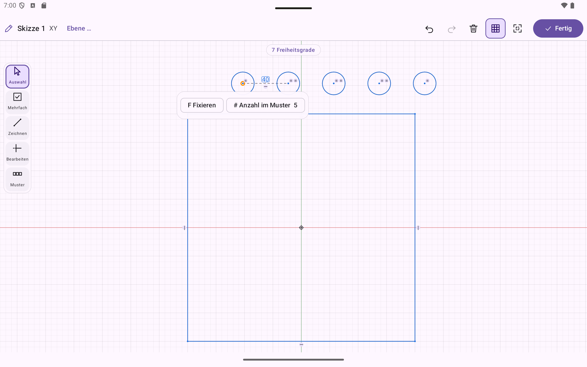
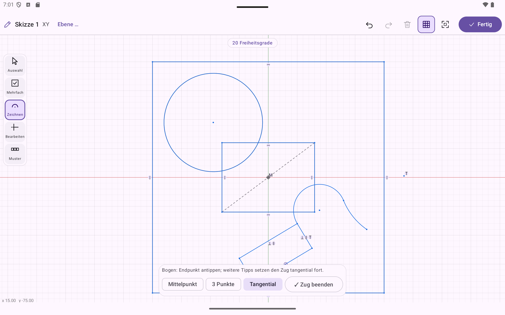
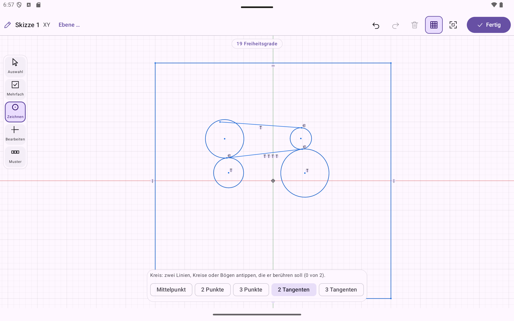
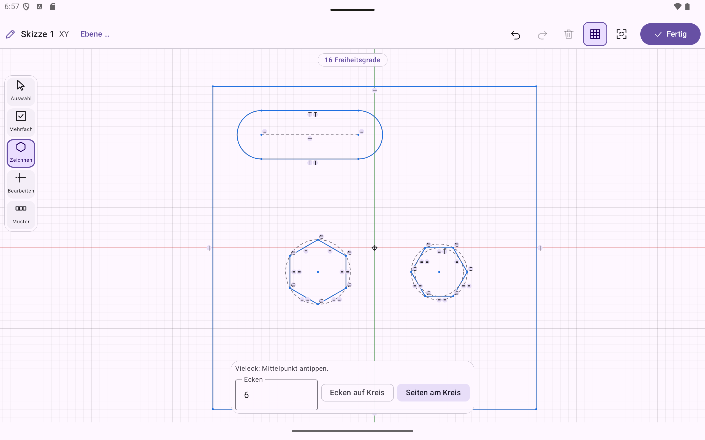

# Roadmap

## Produktrichtung (Stand 02.10.2026)

Ziel ist eine **parametrische CAD-App für Stift und Maus**: Formen und Constraints werden aus **Werkzeugleisten**
gewählt, direkt auf der Skizze gezeichnet und bemaßt; daraus entstehen Körper (Extrusion, Bohrung, Verrundung …).
Vergleichsprodukte sind Shapr3D und Onshape – **nicht** OpenSCAD.

Entscheidungen:
- **Erster Ablauf:** Skizze → Extrusion (2D-Skizze mit Constraints, dann Körper).
- **Geometriekern:** **OpenCascade (B-Rep)** – echte Flächen/Kanten (auswählbar), Verrundung/Fase, STEP-Export.
- **Code-Editor / OpenSCAD:** bleibt als **optionale Erweiterung** (Experten-Modus, Import bestehender `.scad`), wird
  nicht weiter ausgebaut. Manifold bleibt dafür der Kern.

Wiederverwendet wird: Android-Rahmen, adaptive Layouts, Projektspeicher/Autosave, Undo/Redo-Verlauf, OpenGL-Viewport.

## Zielarchitektur

```
:app            Werkzeugleisten, Skizzier-Canvas, 3D-Ansicht mit Auswahl, Eigenschaften-/Bemaßungsleiste
:core:model     Dokument = Feature-Historie (Skizze, Extrusion; später Bohrung, Verrundung …), Regeneration   [Skizze → Körper-Brücke ✓]
:core:sketch    2D-Skizze: Elemente, Constraints, Solver (Newton/Levenberg-Marquardt), Freiheitsgrad-Analyse   [reines Kotlin]
:core:brep      OpenCascade per JNI: Profil → Körper, Booleans, Verrundung, Tessellierung mit Flächen-/Kanten-IDs
:core:lang      OpenSCAD-kompatibler Interpreter (optional)       :core:geometry   Manifold (optional)
:core:project   Projektablage, Undo-Verlauf       :core:json  Mini-JSON      :core:viewport  Kamera, Kantenauswahl
```

Bekannte Schwerpunkte/Risiken: Constraint-Solver (Robustheit, Dragging in Echtzeit), **Topological Naming** (stabile
Referenzen auf Flächen/Kanten nach Parameteränderung), Auswahl/Picking im Viewport, Stift-/Maus-/Touch-Eingabe,
App-Größe (OCCT) und Build-Zeiten.

## Weg zur Veröffentlichung (Plan vom 08.10.2026)

Entscheidungen: Vertrieb über **Google Play**, **Freemium** (Pro als einmaliger In-App-Kauf), **Deutsch + Englisch**, **schlanke 1.0**
(heutiger Stand stabil + Export, Messen, Parameter), weitere Funktionen als Updates. Grobe Dauer: ca. 3–4 Monate.

- [ ] **Phase 0 – Fundament:**
  - [x] App-Name **ParamWorker** (18.10.2026; vorher „Partwright“ – Websuche ergab doch bestehende Nutzungen), App-Kennung
    `io.github.kevbo8327.paramworker` (vorher `…partwright`, davor `dev.androidcad.app`; nach dem ersten Upload nicht mehr änderbar).
    Websuche ohne Treffer in Software/CAD; Prüfung in DPMA/EUIPO/Play Store und Domain durch den Nutzer. Dateiformat-Kennung bleibt `partwright-model`
  - [x] Release-Build: Signatur über nicht eingecheckte `keystore.properties` (sonst Debug-Schlüssel zum Testen), R8 + Ressourcen-Verkleinerung,
    `bundleRelease` → AAB (≈ 16 MB Download je Gerät). Release-APK auf dem Emulator geprüft (Skizze, Extrusion, Verrundung, Lizenzseite – keine
    JNI-/R8-Fehler). Offen: Upload-Schlüssel erzeugen (Nutzer, siehe README)
  - [x] **App-Icon und Startbildschirm:** Stil „Blaupause“: türkise Skizzenfläche, blauer Block mit Tasche, orangefarbener Extrusionspfeil auf Marineblau mit Raster (nach Entwurf des Nutzers); adaptives Vektor-Icon mit
    einfarbiger Ebene (Themensymbole), Startbildschirm über `androidx.core:core-splashscreen` (einheitlich ab Android 8) mit detaillierterem Motiv (Lichtschein, Skizzenlinien,
    verdeckte Kanten) und ab Android 12 dem Schriftzug PARAMWORKER (eigene Linienschrift, keine fremde Schriftart). Alles aus
    `scripts/make-icon.py` erzeugt, dazu Store-Symbol `docs/store/icon-512.png` und Store-Grafik `docs/store/feature-graphic.png`
  - [x] **Automatische Prüfung** (GitHub Actions): JVM-Tests, OpenCascade je ABI mit Zwischenspeicher, Debug-APK und Release-AAB;
    `scripts/build-occt.ps1` läuft dafür auch unter Linux (PowerShell 7, `ANDROID_HOME`)
  - [ ] noch offen:
  Lizenzen (OCCT LGPL → als gemeinsame `.so` ausliefern, Lizenzseite für OCCT/manifold/Clipper2, Lizenz des eigenen Codes);
  signierter Release-AAB (Play App Signing, R8-Regeln für JNI); Test auf echter arm64-Hardware mit Stift; CI (GitHub Actions); App-Icon
  - [x] OpenCascade als **gemeinsame Bibliotheken** (`scripts/build-occt.ps1`, Standard `-LibraryType Shared` → `third_party/occt-android-shared/<abi>`;
    `cadbrep` bindet die `libTK*.so` als importierte Ziele ein, Gradle packt sie mit). Kosten: nativer Teil ≈ 37,6 statt 21,9 MB je ABI (unkomprimiert)
  - [x] Lizenzseite (Projektmenü › „Lizenzen …“) mit OCCT (LGPL 2.1 + Ausnahme, Hinweis zum Austausch), Manifold, Clipper2; Texte in `assets/licenses`, Test `LicensesTest`
- [x] **Farbkonzept „Blaupause“** (08.10.2026): eigenes Material-Farbschema hell/dunkel (`Theme.kt`, Standard **Dunkel**, Umschalter im
  Projektmenü › Darstellung, gemerkt in `UiPrefs`) plus CAD-Farben (`CadColors`): 3D-Ansicht mit Verlaufshintergrund (in OpenGL), Modell in Stahlblau
  mit dunklen Kanten, Auswahl orange; Skizze auf Blaupausen-Raster mit Zustandsfarben (weiß bestimmt, türkis beweglich, rot Widerspruch, gelb Maße).
  **Glas-Flächen** (`Modifier.glass`) für Werkzeugleisten, Karten, Chips, Kontextleiste und Statusplakette: über der Skizze echte Unschärfe mit
  Haze 1.6.10 (neuere Versionen verlangen compileSdk 37), über dem 3D-Bild nachgebildete Glas-Optik (OpenGL-Fläche ist für Compose nicht lesbar).
  Vorschau: `docs/design/farbkonzept-*.png` (`scripts/theme-mockup.py`)
- [ ] **Phase 1 – Umfang 1.0:** ~~**Drehen**~~ ✅ (Revolve, `BRepPrimAPI_MakeRevol`: Achse = Skizzenachse oder Hilfslinie, Teil-/Volldrehung,
  symmetrisch, Hinzufügen/Abtragen, als Muster-Quelle; Prüfung „Profil schneidet die Achse“) und ~~**Schale/Aushöhlen**~~ ✅ (`BRepOffsetAPI_MakeThickSolid`: Öffnungen antippen, Wandstärke; Außen-, Innen- und Randflächen
  benannt, Innenkanten verrundbar) –
  beschlossen am 08.10.2026, Grundwerkzeuge für Wellen/Knöpfe bzw. Gehäuse; ~~**Projekt teilen/importieren**~~ ✅ (⋮ › Projekt exportieren als `.paramworker.json`; Projektmenü › Projekt importieren erkennt
  Modell oder `.scad`; Formatversion wird geprüft, Dateien neuerer App-Versionen werden abgelehnt) (vor der Beta);
  ~~STEP-Export~~ ✅ (OCCT `STEPControl_Writer`, AP214 in mm; DataExchange kostet ca. 17,7 MB je ABI gestrippt), ~~3MF-Export~~ ✅ (⋮ › 3MF exportieren, Modell und Skript; geschlossenes Netz in mm), ~~Messen~~ ✅ (Länge/Radius, Flächeninhalt, kürzester Abstand mit Linie, Winkel), ~~Parameter-Tabelle~~ ✅ (benannte Parameter mit Ausdrücken; Skizzenmaße, Extrusionslänge, Drehwinkel, Wandstärke, Verrundung binden);
  kleine Lücken (Mittelebene, gedrehte Grundebene, Körperumriss direkt antippbar, zwei Layout-Punkte).
  Nach 1.0: Sweep/Loft, Schnittansicht, Ellipse/Spline, Baugruppen
- [ ] **Phase 2 – Qualität:** verständliche Fehler statt Abbruch, Autosave/Wiederherstellen, Grenzen bei großen Modellen,
  Einführung beim ersten Start, Beispielprojekte, Hilfe zu Gesten; Stift/Maus/Chromebook auf echten Geräten; Barrierefreiheit (Grundstufe)
- [ ] **Phase 3 – Übersetzung:** Texte aus dem Code in `strings.xml` (Englisch Standard, Deutsch `values-de`), Meldungen der Kernmodule über Schlüssel
- [ ] **Phase 4 – Freemium** (Aufteilung beschlossen am 08.10.2026; Grundsatz: Konstruieren frei, Pro = Datenaustausch und Arbeitskomfort):
  - **Frei:** alle Skizzen- und Körperwerkzeuge (auch künftige wie Drehen), Messen, **STL-Export**, Projekte teilen/importieren,
    Skript-Editor (OpenSCAD); **keine Begrenzung der Projektanzahl**
  - **Pro (einmaliger Kauf, ca. 15–25 €):** STEP-Export (später Import), 3MF-Export, Parameter-Tabelle; später DXF-Export von Skizzen,
    technische Zeichnungen (PDF), Varianten/Konfigurationen
  - Regeln: eigene Daten nie sperren (immer öffnen, bearbeiten, als STL exportieren); Pro-Funktionen sichtbar mit „(Pro)“ und kurzer Erklärung
  - Technik: Google Play Billing mit Wiederherstellen und Offline-Zwischenspeicher, Sperren zentral in einem `Entitlements`-Objekt
- [ ] **Phase 5 – Store:** Entwicklerkonto, Datenschutzerklärung (öffentliche URL), Data-Safety, Inhaltsbewertung, Store-Eintrag DE/EN mit Screenshots
- [ ] **Phase 6 – Tests und Start:** interner Test → **geschlossener Test mit ≥ 12 Testern über ≥ 14 Tage** (Pflicht für neue Privatkonten; als Beta,
  sobald Projekt-Export und Drehen da sind – Rückmeldungen fließen noch in die 1.0)
  → Produktionszugang → gestaffelter Rollout; Android Vitals beobachten

## Funktionsabgleich mit Shapr3D, Onshape, Fusion, FreeCAD (12.10.2026)

Vorhanden und auf Augenhöhe: Grundformen der Skizze (Linie, Rechteck, Kreis, Bogen, Langloch, Vieleck), Trimmen/Verlängern/Versatz/Ecke,
Spiegeln/Muster, Bedingungen und Maße, Werkzeug **Bemaßen** ✅ (12.10.), **Maße mit Maßlinie, Maßpfeilen, Maßhilfslinien und Maßzahl** ✅ (12.10.;
Abstände in dp über `SketchEditor.uiScale`, auch Treffer- und Fangradius). 3D: Extrudieren, Drehen, Bohrung, Verrundung/Fase, Schale, Muster,
Spiegeln, Arbeitsebenen, Messen, Parameter, Export STEP/3MF/STL.

**Skizze** (Umsetzung mit Subagenten: [PLAN_SKIZZENWERKZEUGE.md](PLAN_SKIZZENWERKZEUGE.md)):
- [ ] vor der Beta: Punkt-Werkzeug, Fase an einer Skizzenecke, Teilen (Element auftrennen)
- [ ] bis 1.0: Verschieben/Drehen/Skalieren/Kopieren der Auswahl, **Text** (größter Hebel beim 3D-Druck)
- [ ] nach 1.0: Ellipse, Spline, DXF/SVG-Import, Kanten anderer Körper/Skizzen übernehmen (auch Schnittkanten)

**3D-Bearbeitung:**
- [x] vor der Beta: Abtragen **durch alles** ✅ (12.10.; Länge aus der Hüllbox des Körpers in Extrusionsrichtung, wächst mit dem Körper mit)
- [ ] bis 1.0: „bis Fläche“ und zwei Seiten mit verschiedenen Längen, Schnittmenge als dritte Art beim Extrudieren, Bohrungen mit Senkung/Kegelsenkung
  und Normgrößen (M3–M10), Schnittansicht, ggf. Loft (`BRepOffsetAPI_ThruSections`)
- [ ] nach 1.0: Sweep, STEP-Import, Fläche ziehen/versetzen (direkte Bearbeitung), Gewinde (modelliert), mehrere Körper mit Booleschen
  Operationen und Körper teilen, Formschräge/Rippe/Aufdicken, Masse mit Dichte

**3D-Druck / Slicer** (Idee vom 15.10.2026):
- [ ] 1.1: **„Drucken …“** – 3MF über das Android-Teilen-Menü (FileProvider) direkt an eine installierte Slicer- oder Drucker-App übergeben;
  der 3MF-Export selbst ist schon da (`ModelScreen.kt`). Aufwand ca. ein Tag.
- [ ] später, nur mit eigenem Slicer sinnvoll: G-Code direkt an den Drucker im Netzwerk senden (Klipper/Moonraker, OctoPrint).
- [ ] Idee: **Slicer in der App.** Erst angehen, wenn Tester es ausdrücklich wünschen. Die gängigen Kerne (CuraEngine, PrusaSlicer,
  OrcaSlicer, Slic3r) stehen unter **AGPL-3.0**. Eingebaut würde die Lizenz für die ganze App gelten und passt nicht zum Freemium-Modell;
  vorher rechtlich prüfen lassen. Umfang: Druckerprofile, Stützen, Schichtvorschau.

## Meilensteine

### M0 – OpenCascade-Machbarkeit  (fast abgeschlossen)
- [x] OCCT V7_9_3 (Quelltext) eingebunden, Build-Skript `scripts/build-occt.ps1` (statisch, nur Modellierungsmodule, ohne Fremdbibliotheken)
- [x] OCCT für **x86_64** gebaut (≈ 25 min auf 32 Kernen, 711 MB statische Archive – im gelinkten `.so` nur 20,5 MB gestrippt)
- [x] `:core:brep` (JNI): Profil aus Linien/Bögen/Kreisen mit Löchern → Extrusion, Booleans, Verrundung, Kanten-Info, Tessellierung mit Flächen-ID je Dreieck und Kanten-Polylinien
- [x] 12 Instrumented Tests (x86_64-Emulator): exakte Volumina, Topologie (Flächen-/Kantenzahl), Bögen beide Richtungen, Booleans, Verrundung, Fehlerfälle (offene Kontur, Lücke, zu großer Radius)
- [x] Zeit für Platte + 4 Bohrungen + 4 Verrundungen + Tessellierung: Ø 77 ms (max 193 ms) auf dem Emulator, bei voller CPU-Auslastung durch den parallelen arm64-Build
- [x] OCCT für **arm64-v8a** gebaut; `:core:brep` baut für beide ABIs in Debug und Release (gestripptes `.so`: 18,8 MB arm64 / 20,5 MB x86_64; AAR komprimiert 17 MB)
- [ ] **Offen:** Tests auf arm64 (Emulator-Test lief nur auf x86_64; echte arm64-Hardware / arm64-Emulator steht aus)
- **Gate M0:** Läuft auf Emulator (x86_64) **und** arm64, App-Größenzuwachs akzeptabel, Zeiten < 200 ms für einfache Teile

Offene Punkte aus M0: Gesamt-APK-Größe mit beiden ABIs messen; Release-Build; Topological Naming (stabile Flächen-/Kanten-Referenzen)
prototypisch klären, bevor das Feature-Modell (M3) festgelegt wird.

### M1 – Skizzen-Engine (`:core:sketch`, JVM-testbar)  ← **Kern fertig**
- [x] Elemente: Punkt, Linie, Kreis, Bogen (Mittelpunkt, Start, Ende; gegen den Uhrzeigersinn), Konstruktionselemente, Ursprung
- [x] 16 geometrische Constraints: zusammenfallend, Punkt auf Linie/Kreis, Mittelpunkt, horizontal/vertikal (Linie und Punktpaar),
  parallel, senkrecht, kollinear, gleich lang, gleicher Radius, konzentrisch, Tangente (Linie–Kreis, Kreis–Kreis innen/außen),
  symmetrisch, fest (auch nur eine Achse)
- [x] 8 Bemaßungen: Abstand, horizontal, vertikal, Länge, Punkt–Linie-Abstand (seitentreu), Radius, Durchmesser, Winkel
- [x] Solver (Levenberg-Marquardt, numerische Jacobi-Matrix je Gleichung): bleibt bei unterbestimmten Skizzen nahe an der Zeichnung
- [x] Analyse: Freiheitsgrade, vollständig bestimmte Punkte/Linien/Kreise/Bögen (für Farbmarkierung), **überflüssige** und **widersprüchliche** Constraints
- [x] Ziehen mit Solver (`DragSession`): Constraints haben Vorrang, Ziel wird so gut wie möglich angenähert
- [x] Regionen (`Sketch.regions()`): geschlossene Konturen mit exakter Fläche, verschachtelte Löcher/Inseln, Meldungen für offene Enden und Verzweigungen
- [x] 38 JVM-Tests inkl. Zufallstests: 300/300 verwackelte Polygone gelöst, 400/400 Ziehschritte, Gitter 8×8 (> 128 Variablen):
  Lösen 36 ms, Ziehschritt 3,4 ms
- [ ] **Offen in M1:** Auto-Constraints beim Zeichnen (Fangen, „horizontal/vertikal/tangential vorschlagen“), Referenzmaße (nicht treibend),
  Maße als benannte Parameter/Ausdrücke, 2D-Operationen (Trimmen, Verlängern, Versatz, Verrunden),
  Spline/Ellipse, Regionen mit Verzweigungen (T-Stücke/Kreuzungen), Konfliktauflösung (minimale widersprüchliche Menge)
- [x] **Brücke Skizze → Körper** (`:core:model`): `Region.toProfile()`, `Workplane` (XY/XZ/YZ + Versatz), `Document` mit Feature-Historie
  (Skizze, Extrusion hinzufügen/abtragen, symmetrisch, negative Richtung, Flächenauswahl über Punkte, Fehler je Feature statt Abbruch),
  `Document.build()` löst die Skizzen und baut den Körper neu. Beispielmodell `PlateModel` (vollständig bemaßte Platte mit 4 Bohrungen).
  Messung: Maß ändern → Skizze lösen → Körper → Netz Ø 12,7 ms (Emulator), in der App 60 ms inkl. Anzeige.
- [x] App-Tab **Modell** (Standard): Arbeitsfläche mit Skizze + 3D-Körper, Kanten, Kennzahlen, STL-Export

### M2 – Skizzier-Oberfläche  ← **Kern fertig und auf dem Emulator geprüft**
- [x] `:core:sketchedit` (reines Kotlin, 42 JVM-Tests): Werkzeug-Zustandsautomat für Auswahl (Tippen, Fensterauswahl, mehrfach), Ziehen mit Solver,
  Linie (Klick-Klick-Linienzug, Stift: ziehen), Rechteck, Kreis, Bogen (Mittelpunkt/Start/Ende); **Fangen** (Punkt, Mitte, auf Linie/Kreis/Bogen, Achsen, Raster);
  **Auto-Constraints** (zusammenfallend/gemeinsamer Punkt, auf Kurve, Mittelpunkt, Achse, horizontal/vertikal bei < 3°);
  **kontextabhängige Constraint- und Maß-Aktionen** (nur, was zur Auswahl passt; widersprüchliche oder überflüssige werden abgelehnt und zurückgenommen);
  Maße als Etikett antippen = Wert ändern; Konstruktionselemente; Löschen, Radierer (Stiftende); Rückgängig/Wiederholen; Ansicht (Zoom um Zeiger, Verschieben, Einpassen)
- [x] Compose-Oberfläche: Zeichenfeld (Raster, Achsen, Farbe je Bestimmtheit: blau = beweglich, dunkel = vollständig bestimmt, rot = Widerspruch;
  Constraint-Symbole, Maßetiketten, Fangmarke, Vorschau), Werkzeug- und Aktionsleiste, Constraint-Leiste mit Statuszeile (Freiheitsgrade), Wertdialog
- [x] Eingabe: Maus (Hover-Fang, Mausrad-Zoom, mittlere Taste = Verschieben, rechte Taste = Abbrechen), Stift (Ziehen zeichnet, Radierer-Ende löscht),
  Touch (Zwei-Finger-Zoom/-Verschieben, größere Trefferzonen, „Fertig“-Schaltfläche), Tastatur (Esc, Entf, Strg+Z/Y, L R C A S)
- [x] **Speichern im Projektspeicher:** Skizzen und Modell (Feature-Historie, Ebenen, Extrusionsparameter) als versioniertes `model.json`
  (`:core:json`, `SketchCodec`, `DocumentCodec`), `ModelRepository` (atomar, eine Sicherung `.bak`), `ModelSession` (Wiederherstellen beim Start,
  Öffnen/Umbenennen/Duplizieren/Löschen, beschädigte Dateien werden nie überschrieben); Autosave 700 ms + `onStop`; Projektmenü in der App.
  Auf dem Emulator geprüft: Prozess hart beendet → Skizze, Maße und Körper (31,10 cm³) kommen unverändert zurück.
- [x] **Zwei Modi statt geteilter Ansicht:** *Skizzenmodus* (2D-Vollbild, „✓ Fertig“) und *Modellmodus* (3D-Vollbild, Feature-Leiste, Extrusion/Abtrag/Verrundung/Fase). „Fertig“ schwenkt die Kamera animiert von der Skizzenebene
  (XY/XZ/YZ, `ViewCamera.planeView`) in die isometrische Ansicht; die Skizze bleibt als Linien auf ihrer Ebene im 3D-Bild sichtbar (`SketchFeature.worldSegments`, ohne Tiefentest).
  Zurück per „✎ Skizze bearbeiten“ oder erneutes Antippen der gewählten Skizze in der Feature-Leiste; ein neues leeres Modell beginnt im Skizzenmodus.
- [x] Live-Kopplung: jede Änderung der Skizze baut den Körper aus einer Dokument-Momentaufnahme im Hintergrund neu (Ziehen: ≈ 3 ms Neuaufbau)
- [x] **2D-Skizzenwerkzeuge** (`SketchOps`, Werkzeugleiste ✂ ⇥ ⧉ ◜ ⇋): **Trimmen** (Linie/Kreis/Bogen bis zu den nächsten Schnittpunkten; Linie wird geteilt, Kreis wird Bogen, neue Punkte liegen per Constraint auf der schneidenden Kurve),
  **Verlängern** (Linien- und Bogenenden bis zum nächsten Element), **Versatz** (Element antippen, dann Seite; Linienketten samt Ecken als parallele Linien mit Abstandsmaß, Kreise/Bögen konzentrisch mit Radiusmaß),
  **Eckenverrundung** (Bogen tangential zu beiden Linien mit Radiusmaß) und **Spiegeln** (an einer Linie oder der X-/Y-Achse; Kopien über Symmetrie-Constraints gebunden). Fehlschläge nehmen alles zurück; jede Aktion ist rückgängig machbar.
- [x] **Skizzenmuster** (Werkzeuggruppe „Muster“ der Skizze): Auswahl → **Reihe** (Linie als Richtung antippen – die Seite bestimmt die Richtung – oder X/Y; Anzahl, Abstand) bzw. **Kreis**
  (Punkt/Kreis als Mittelpunkt oder Ursprung; Anzahl, Winkel, 360° = voller Kreis). Parametrisch über neue Constraints `Translated` (b − a = Mustervektor, eine Hilfslinie mit Längenmaß = Abstand)
  und `Rotated` (Drehung um den Mittelpunkt); Kreise über eine Kette gleicher Radien. Bestimmtheit bleibt erhalten (bestimmtes Original → bestimmte Kopien). Emulator: 6 Kreise um den Ursprung; Rechteckreihe, Abstand per Maß 25 → 40, extrudiert
- [x] **Anzahl eines Skizzenmusters nachträglich ändern**: Original oder Kopie antippen → „# Anzahl im Muster“. Das Muster wird an seinen `Translated`-/`Rotated`-Ketten erkannt
  (`SketchOps.patternOf`, keine eigene Musterverwaltung nötig); mehr Exemplare hängen sich an die letzte Kopie, weniger entfernen die letzten samt Bedingungen
  (`SketchOps.setPatternCount`). Kreismuster über 360° verteilen sich neu, Teilkreise behalten ihren Gesamtwinkel. Ganze Zahl 2 … 100, rückgängig machbar
  
- [x] **Zeichenvarianten, Gruppe 1**: Variante als Chips in der Kontextleiste des Werkzeugs (zuletzt gewählte bleibt gemerkt, `UiPrefs`). **Rechteck** Ecke–Ecke,
  vom **Mittelpunkt** (Hilfsdiagonale + `Midpoint`, bleibt mittig z. B. auf dem Ursprung), aus **3 Punkten** (schräg: ⊥ + zweimal ∥, 5 Freiheitsgrade).
  **Kreis** über Mittelpunkt, **2 Punkte** (Durchmesser), **3 Punkte** – gefangene vorhandene Punkte bleiben auf dem Kreis (`PointOnRound`). **Bogen** über
  Mittelpunkt, **3 Punkte** (Start, Ende, Punkt dazwischen – die Laufrichtung folgt dem mittleren Punkt) und **tangential** am Ende einer Linie bzw. eines Bogens
  (`TangentLineRound` bzw. `TangentRoundRound`), als Zug fortsetzbar. Tests `DrawVariantsTest`; Emulator: alle Varianten auf dem Pixel Tablet
  
- [x] **Zeichenvarianten, Gruppe 2 (Tangenten)**: **Linie „Tangential“** – endet sie auf einem Kreis/Bogen, berührt sie ihn dort (ein Ende: Tangente von einem
  Punkt aus; beide Enden: Tangente zwischen zwei Kreisen, z. B. Riementrieb), als Zug. **Kreis an 2 Tangenten** (zwei Linien/Kreise/Bögen antippen, dann die Lage –
  sie bestimmt die Größe) und **an 3 Tangenten** (voll bestimmt, z. B. Inkreis). Der Löser findet die Berührstellen; vorhandene Geometrie wird dabei kurz
  festgehalten, damit sich nur das Neue bewegt (`placeNew`). Vorschau über eine Probe auf einer Kopie der Skizze. Außerdem: Tipps auf die Kontextleiste
  landen nicht mehr auf der Zeichenfläche. Tests `TangentDrawTest`
  
- [x] **Zeichenvarianten, Gruppe 3**: Werkzeuge **Langloch** (Mitten der beiden Rundungen, dann die Breite; zwei gleiche Halbkreise, zwei tangentiale Linien,
  Hilfs-Mittellinie für die Länge – 5 Freiheitsgrade) und **Vieleck** (3 … 64 Ecken; Mittelpunkt, dann Ecke bzw. Seitenmitte; „Ecken auf Kreis“ oder „Seiten am Kreis“
  mit Inkreis = Schlüsselweite – 4 Freiheitsgrade, auch bei gerader Eckenzahl kein Kippen wie bei einer Raute). Eckenzahl und Variante bleiben gemerkt.
  **Löser:** Tangential-Bedingungen an einer gemeinsamen Berührstelle (Bogenende oder Punkt auf dem Kreis) werden als „Radius ⟂ Linie“ bzw. „Mittelpunkte und
  Punkt auf einer Geraden“ formuliert – gleichwertig, aber ohne scheinbare Freiheitsgrade (vorher galt das Ende als frei entlang der Tangente; betraf auch
  Eckenverrundung und tangentiale Bögen). Tests `SlotPolygonTest`, `TangencyDofTest`
  
- [x] **Lage der Skizze bestimmen**: X- und Y-Achse sind antippbar (feste Konstruktionslinien, `SketchOps.axisOf`) – alle Bedingungen/Maße gelten auch gegenüber den Achsen (Auf Kurve, Kollinear,
  Symmetrisch, Abstand, Winkel …; Unsinniges wie „Gleich“/„Fixieren“ wird bei gewählter Achse nicht angeboten). Schnellaktionen **„Ecke auf Ursprung“** und **„Mittig auf Ursprung“** (Hilfsdiagonale mit dem Ursprung
  als Mittelpunkt – bleibt bei Maßänderungen mittig). Statuszeile erkennt „Form bestimmt – Lage (und Drehung) noch frei“ (`SketchOps.placementFreedom`, Drehung per Probe-Drehung geprüft). Ursprung deutlicher
  (Ring) und großzügiger antippbar; „Einpassen“ nimmt den Ursprung mit ins Bild, sofern er nicht weit entfernt liegt
- [x] **„Mittig auf Fläche“** (Skizzen auf einer Körperfläche): projiziert bei Bedarf den Umriss der Fläche und setzt die Mitte der gewählten Form (Kreis: Mittelpunkt) über einen Hilfspunkt
  auf die Mitte der Flächendiagonale (`SketchOps.centerOn`, Ziel `CenterTarget.Diagonal`; runde Flächen: Mittelpunkt). Folgt der Fläche bei Maßänderungen am Körper. Projizierte Referenzen zeigen keine
  „F“-/Radius-Kennzeichen mehr; „Lage frei“ wird per Verschiebe-/Drehprobe erkannt (keine Fehlmeldung, wenn nur die Größe frei ist). Emulator: Block mittig auf der Platte, Platte 80 → 120 mm, Block bleibt mittig
- [x] **„Mittig auf Bohrung“ / „Mittig zur Kante“**: Form plus genau eine projizierte Bohrung bzw. Kante wählen. Bohrung: Mitte der Form (Kreis: konzentrisch) auf den Bohrungsmittelpunkt.
  Kante: Mitte der Form auf der Mittelsenkrechten der Kante (Hilfslinie von der Kantenmitte, senkrecht zur Kante) – der Abstand zur Kante bleibt frei. Beides folgt dem Körper. Emulator: Kreis auf Bohrung,
  Rechteck mittig zur unteren Plattenkante
- [x] **Layout**: Modellaufbau einklappbar (Standard eingeklappt, ‹ › blättert, Wahl bleibt über Neustarts), Lage-Aktionen der Skizze unter „Ausrichten ▾“, Aktionszeile mit fester Höhe
- [x] **Overlay-Layout, Schritt 1 (Modellmodus)**: 3D-Bild vollflächig, Werkzeuggruppen mit aufklappbarer Leiste (Tablet links, Smartphone unten), Einstellungen als schwebende Karte bzw. Blatt
  (nur bei Auswahl/Werkzeug, einklappbar, ✕), Verlauf als Chip „Schritt ‹ ›“ und Karte auf Wunsch, „Ansicht“-Menü; Volumen/STL auf dem Smartphone im ⋮-Menü. Getestet auf Pixel Tablet und Pixel 10 Pro XL
- [x] **Overlay-Layout, Schritt 2 (Skizzenmodus)**: Zeichenfläche vollflächig, Werkzeuggruppen (gemeinsam mit dem Modellmodus), Status-Plakette, Kontextleiste an der Auswahl bzw. für das
  laufende Werkzeug, kompakte Kopfzeile mit ⋮-Menü auf dem Smartphone. Getestet auf Pixel 10 Pro XL und Pixel Tablet
- [x] **Overlay-Layout, Schritt 3 (kleine Geräte)**: Werkzeuge unten/Einstellungen als Blatt unter 720 dp Breite **und** im Hochformat (auch Tablets), kompakte Kopfzeile nur unter 600 dp;
  3D-Bild rückt neben offene Karten (Modell im freien Bereich zentriert); Skizze passt mit freien Rändern für Werkzeugleiste und Statusplakette ein (`SketchEditor.fit(left, top)`) und passt beim Drehen
  neu ein. Geprüft: Pixel Tablet, 8″-Tablet quer/hoch (960 × 600 dp), Smartphone hoch/quer (448 × 997 dp)
- [ ] **Offen in M2:** Zeichenvarianten später: Ellipse und Spline; vorhandenen Körper im Skizzenmodus blass als Referenz zeigen, optionale 3D-Vorschau auf breiten Fenstern, freie Ebenen (Kamera auf beliebige Normale ausrichten), Bemaßen per Ziehen eines Etiketts (Position), Bemaßungs-Vorschlag beim Zeichnen, Fase in 2D, Trimmen von Kreisen/Bögen an Elementen mit Maßen (Maße der gekürzten Linie entfallen),
  Ellipse/Spline, Skizzenebene auf eine Körperfläche legen (XZ/YZ/Versatz ✓), Constraint-Leiste: „deaktiviert“ statt versteckt bei unzulässigen Aktionen,
  Stift-Gesten (z. B. Durchstreichen = Löschen), Zwei-Finger-Tippen = Rückgängig

### M3 – 3D-Modellierung  (Grundlage steht: `:core:model`)
- [x] Feature-Historie mit Skizze und Extrusion (Hinzufügen/Abtragen), Regeneration bei Änderung
- [x] **Feature-Leiste** (App): mehrere Skizzen und Extrusionen in Aufbau-Reihenfolge wählbar; neue Skizze mit **Ebenenwahl** (XY/XZ/YZ + Versatz),
  Ebene nachträglich ändern; Extrusion **Hinzufügen/Abtragen** mit Länge, symmetrisch, umgekehrt; Umbenennen, Löschen (mit abhängigen Features).
  Emulator: Platte → Skizze auf XY +8 mm → Abtrag: 31,10 → 23,34 cm³, Wiederherstellung nach Prozess-Ende ✓
- [x] **Verrundung und Fase** als Feature: Kanten im 3D-Bild antippen (nur sichtbare, CPU-Strahltest gegen das Netz), Auswahl wird orange hervorgehoben,
  Radius/Abstand per Schieber, Art umschaltbar; Kanten werden über ihre Nachbarflächen (`EdgeRef`) gespeichert und nach Maßänderungen wiedergefunden;
  nicht mehr auffindbare Kanten melden einen Fehler am Feature, der Rest wird weitergebaut; Löschen entfernt abhängige Features mit
- [x] **Bohrung** als Feature: ebene Fläche im 3D-Bild antippen (Strahl gegen das Netz, `FacePicker`), Markierung (Kreis + Fadenkreuz) zeigt Ort und Durchmesser, dann Durchmesser,
  Tiefe oder „Durchgehend“ einstellen; die Fläche wird über `FaceRef` gespeichert, die Position als Raumpunkt (beim Bauen auf die Fläche projiziert); Wand und Boden der Bohrung sind benannt
  (Bohrung in Bohrungsboden möglich). Emulator: Platte + Bohrung Ø6 durchgehend: 31,10 → 30,87 cm³
- [x] **Parametrische Bohrungsposition:** Beim Setzen wählt die App automatisch die zwei nächsten, nicht parallelen geraden Randkanten der Fläche und speichert die Abstände (`EdgeDistance`);
  die Abstände sind als Eingabefelder editierbar, die Referenzkanten werden hervorgehoben, die Bohrung wandert bei Maßänderungen mit den Kanten (`HolePlacement`, Vorzeichen unabhängig von der Kantenorientierung).
  Fehler (parallele oder gekrümmte Referenzkanten, Kante verschwunden) melden sich am Feature.
- [ ] Weitere Features: Spiegeln, Muster; Referenzkanten/Bohrungen nachträglich neu wählen; Bohrungsposition auch per Maß zu Skizzenpunkten
- [x] Auswahl von Kanten im Viewport (`:core:viewport`: gemeinsame Kamera für Renderer und Antippen, `EdgePicker`)
- [x] Auswahl von Flächen im Viewport (`FacePicker`)
- [x] **Skizze auf einer Körperfläche** („▭ Skizze auf Fläche …“): ebene Fläche antippen → Skizze hängt per `FaceRef` an der Fläche; ihre Ebene (`FacePlane`: Außennormale, Fußpunkt des Weltursprungs,
  x waagerecht) wird bei jedem Neuaufbau neu berechnet und **folgt der Fläche** bei Änderungen (Dicke usw.); im Skizzenmodus erscheint der Umriss des Körpers in dieser Ebene als graue Referenz,
  „Einpassen“ schließt ihn ein; die Kamera schwenkt für jede Ebene mit waagerechter x-Achse exakt senkrecht auf die Skizze (`ViewCamera.planeView`).
  Emulator: Kreis auf dem Plattendeckel → Zapfen +1,13 cm³; nach Neustart unverändert
- [x] **Projizierte Referenzkanten** („⎘ Kanten projizieren“ in Flächenskizzen): Umriss und Löcher der Fläche werden als feste Konstruktionslinien/-kreise in die Skizze gelegt (`EdgeProjection`, `SketchFeature.projections`);
  Maße und Constraints lassen sich daran binden („Kreis 20 mm von der Kante“). Die Kanten werden über ihre Nachbarflächen (`EdgeRef`) gefunden und bei jedem Neuaufbau nachgeführt – die Skizze folgt dem Körper.
  Emulator: Kreis mit Maß 20 zur rechten Kante, Freiheitsgrade 3 → 2
- [x] **Muster und Spiegelung** („▦ Reihe“, „✲ Kreismuster“, „⇋ Spiegeln“ an Extrusion oder Bohrung): `PatternFeature` vervielfältigt das Werkzeug des Quell-Features
  (verschoben, um eine Achse gedreht oder an einer Ebene gespiegelt), vereinigt alle Kopien zu **einem** Werkzeug und wendet es mit der Operation der Quelle an (atomar: bei Fehler bleibt der Körper unverändert).
  Jede Kopie hat eigene stabile Flächennamen (`FaceRef(Muster, Rolle, Kopie<<20 | Element)`), Verrundungen/Bohrungen können sich darauf beziehen. Anzahl, Abstand/Winkel, Achse und Ebene sind live einstellbar.
  Emulator: Bohrung als Kreismuster, Achse verschoben → Volumen und Flächen folgen
- [x] **Muster von Mustern** (eine Ebene): ein einfaches Muster lässt sich wieder vervielfältigen (Reihe → Raster, Reihe spiegeln, Kreis von Reihen); kopiert wird das ganze Ergebnis des inneren Musters,
  Flächennamen tragen äußere und innere Kopie (`((j·256 + k) shl 20) or Element`, Element jetzt 40 Bit/`Long`); Verrundungen an verschachtelten Kopien überstehen Maßänderungen. Emulator: Bohrungsreihe → Raster
- [x] **Muster von Verrundungen**: Schalter „Verrundungen/Fasen der Quelle mitnehmen“ (`PatternFeature.withFillets`, beim Anlegen automatisch an, wenn es welche gibt).
  Übertragen werden alle Verrundungen/Fasen zwischen Original und Muster, deren Kanten an Flächen des Originals hängen (Zapfen-Oberkante, Senkung einer Bohrung) – je Kopie über deren Flächennamen
  wiedergefunden, bei verschachtelten Mustern für jede Kopie des Rasters. Mit gewählter Verrundung legt „Reihe/Kreis/Spiegeln“ das Muster ihres Features an (bei Senkungen die Bohrung, nicht die Platte).
  Emulator: gesenkte Bohrung → Reihe mit drei gesenkten Bohrungen, Schalter aus/an (14 ↔ 16 Flächen)
- [x] **Zweite Richtung beim Linearmuster**: Schalter „Zweite Richtung (Raster)“ mit eigener Achse, Anzahl und Abstand (höchstens 200 Exemplare, Richtungen quer zueinander);
  Kopie in Spalte a, Zeile b heißt `((b·256 + a) shl 20) or Element` – die erste Zeile wie eine einfache Reihe, Namen bleiben bei geänderter Zeilenzahl. Ein Raster lässt sich nicht weiter vervielfältigen.
  Emulator: Bohrung → Reihe → zweite Richtung an → 3 × 2 Bohrungen
- [x] **Körper spiegeln** (`MirrorBodyFeature`): ganzer bisheriger Körper an einer Koordinatenebene (Achse + Lage) oder einer Arbeitsebene (folgt ihr) gespiegelt und vereinigt;
  Werkzeug „Spiegeln“ ohne spiegelbares Feature in der Auswahl (Vorgabe: YZ-Ebene an der linken Körperseite, an der gewählten Arbeitsebene) oder per Knopf aus einer Feature-Spiegelung. Gespiegelte Flächen
  heißen `FaceRef(Spiegelung, Rolle, (Feature shl 25) or Element)` – Verrundungen am Spiegelbild überstehen Maßänderungen. Emulator: Platte an x = 0 → doppelte Platte, nochmals an der linken Seite → vierfach
- [x] **Naht beim Körperspiegeln entfernt**: nach dem Vereinigen werden Flächen derselben Fläche zusammengeführt (`BrepShape.unifyFaces`, OCCT `ShapeUpgrade_UnifySameDomain` mit Verlauf).
- [x] **Keine Nähte nach Booleans**: jedes Hinzufügen/Abtragen (Extrusion, Bohrung, Muster, Spiegeln) führt danach Flächen derselben Fläche zusammen (`Document.combine`).
  Zwei bündige Blöcke ergeben einen Quader mit 6 Flächen; Deckel und Seiten sind unter den Namen beider Extrusionen auffindbar, eine Rundung an der Kante läuft über die
  ganze Länge, Skizzen auf der Fläche des jüngeren Blocks finden ihre Ebene weiter. Schlägt das Zusammenführen fehl, bleibt der Körper mit Naht (Test `SeamlessBooleanTest`)
  Flächen haben dafür neben dem Hauptnamen **Zweitnamen**; die zusammengeführte Fläche heißt nach dem ältesten Feature, die übrigen Namen bleiben als Zweitnamen gültig (Suche über `facesWithTag`/`edgesBetween`,
  weitergereicht durch Booleans, Verrundungen, Transformationen und `retag`). Emulator: gespiegelte Platte 14 statt 18 Flächen, eine Verrundung läuft über die volle Länge
- [ ] tiefere Verschachtelung
- [x] **Arbeitsebenen** (`PlaneFeature`, Werkzeug „Ebene“): Fläche antippen → Ebene mit **Abstand** zur Fläche oder **gedreht an einer geraden Kante** der Fläche (Winkel, Drehachse umschaltbar, im Bild hervorgehoben);
  „Skizze auf dieser Ebene“; Ebene und Skizzen folgen dem Körper bei Maßänderungen (`DatumPlane.resolve` bei jedem Aufbau, letzte Lage als Rückfall). Im 3D-Bild als Rahmen mit Normalenpfeil.
  Emulator: Ebene 30° an der Vorderkante der Platte → Kreis darauf → schräger Zapfen
- [ ] Ebene aus 3 Punkten / durch Achse, Ebenen auf Ebenen, Skizze auf gekrümmten Flächen, Referenzen auch für Kanten, die die Ebene nur schneiden (Punkt-Projektion), einzelne Kanten per Antippen projizieren
  **Topological Naming** (stabile Referenzen über Parameteränderungen) – Prototyp ✓, siehe [TOPOLOGICAL_NAMING.md](TOPOLOGICAL_NAMING.md); Features müssen noch `FaceRef` verwenden
- [ ] Parameter-Tabelle mit benannten Parametern/Ausdrücken, (Speichern/Laden des Dokuments ✓)

### M4 – Abrunden
- Export STL/3MF/STEP, Messen, Schnittansicht, Muster, Googlebook-/Tablet-Tests (arm64, Stift), Release-Builds

## Bereits erledigt (Vorarbeit, bleibt nutzbar)
- Gradle-Projekt (AGP 9, Kotlin 2.3, Compose), NDK/CMake-Toolchain, 16-KB-Alignment, x86_64 + arm64-v8a
- OpenSCAD-kompatibler Interpreter, Customizer, Manifold-Anbindung, Volumenvergleich mit OpenSCAD (≤ 0,013 %)
- App-Rahmen: adaptives Layout, OpenGL-Viewport, STL-Export, Projekte mit Autosave, Undo/Redo, Strg-Kürzel
